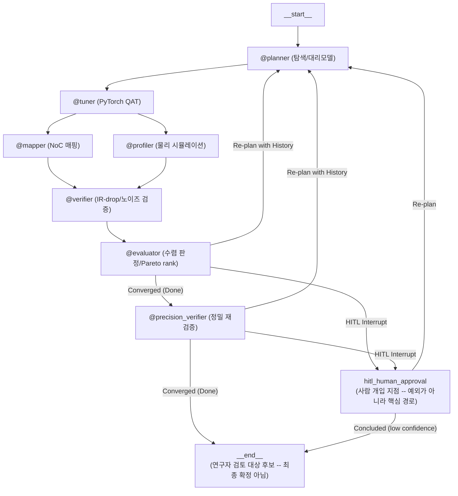

# AutoCIM-Agent

**CIM(Compute-In-Memory) 반도체를 위한 LangGraph 기반 8-노드 폐루프 HW-SW 공동설계 연구 플랫폼 — 사람의 검토를 전제로 후보를 생성·검증하는 도구** (LLM의 역할은 의도적으로 제한돼 있습니다 — [아래](#이-프로젝트는-멀티에이전트-시스템이-아닙니다) 참고)

레이어별 양자화 비트/컬럼 프루닝 비율과 크로스바 하드웨어 제약(ADC/DAC 해상도, IR-drop, 소자 노이즈)을 함께 고려해, 정확도·에너지·지연시간의 Pareto 후보를 탐색하고 실제 QAT/물리 시뮬레이션/2단계 정밀 재검증으로 매 후보를 검증하는 폐루프(closed-loop) 파이프라인입니다. **"탐색이 사람이나 더 단순한 방법보다 낫다"는 주장을 하는 프로젝트가 아닙니다** — 그 대신 (1) mock 자리 표시자를 실제 물리 모델로 하나씩 교체해온 과정, (2) 매 교체마다 실제 실행으로 재검증하며 발견한 진짜 버그들, (3) 이 시스템이 실제로 잘하는 것과 못하는 것을 실측으로 정직하게 특성화한 결과를 남기는 것을 목표로 합니다 (아래 "실측으로 확인한 것" 참고). 처음 접하는 개념(CIM/크로스바/ADC·DAC/양자화/파레토 탐색)은 [`docs/concepts.md`](docs/concepts.md)를, 배경과 전체 설계 의도는 [`docs/research_plan.md`](docs/research_plan.md)를, 코드 작성 규칙은 [`docs/coding_guidelines.md`](docs/coding_guidelines.md)를 참고하세요.

## 아키텍처

이 파이프라인의 "완료"(`__end__`) 상태는 최종 확정이 아니라 **사람이 검토할 후보가 준비됐다는 뜻**입니다. `hitl_human_approval`도 예외 처리 경로가 아니라, 이 시스템의 신뢰성 한계(아래 실측 결과 참고) 때문에 실제로 자주 타는, 설계상 핵심적인 경로입니다.



> `hitl_human_approval`에서 나가는 두 경로는 `graph.py`의 `hitl_router`가 고릅니다: 연구자가 새 탐색 범위를 승인하면 `@planner`로 돌아가고, 더 진행하지 않고 **지금까지의 최선 후보로 종결**하기로 하면(수동 [3]번 선택, 또는 `--auto-hitl`이 라운드 상한에 도달) `low_confidence_conclusion` 표시와 함께 바로 `__end__`로 갑니다 — 이 경우 `@precision_verifier`를 건너뜁니다(애초에 목표를 만족한 적 없는 후보라 정밀 재검증이 확인할 게 없기 때문). 이 표시가 붙은 결과는 `is_converged`를 `True`로 보고하지 않으며, CLI 최종 출력과 대시보드 모두 "검토 필요"로 구분해 보여줍니다.

| 노드 | 역할 | 실제 구현 여부 |
|---|---|---|
| `@planner` | LHS 워밍업 + IDW 대리모델 기반 다중목적(accuracy/energy_pj/noc_latency_ms) NSGA-II 탐색(`pymoo`, stage별 독립, 최대 40차원)이 수치를 확정하고, LLM은 도구 호출로 근거(rationale) 설명과 이상 징후(anomaly) 플래깅만 담당 (수치 판단 없음) | 실제 |
| `@tuner` | 크로스바 컬럼(출력 채널)별 독립 스케일을 쓰는 column-wise 가중치 fake-quantization + partial-sum(ADC 직전 출력) 양자화 + 구조적 컬럼 프루닝, 실제 QAT fine-tuning (`tools/qat.py`) | 실제 (CIFAR10 서브셋, CUDA/MPS/CPU 자동 감지) |
| `@mapper` / `@profiler` | NoC 홉카운트/대역폭 매핑, ADC/DAC/크로스바 에너지·지연 물리 시뮬레이션 | 실제 (fast-approximation) |
| `@verifier` | IR-drop/노이즈 마진 기반 수렴 판정 | 실제 |
| `@evaluator` | Pydantic 스키마 검증, NSGA-II 스타일 Pareto rank, 재탐색/HITL 라우팅 | 실제 |
| `@precision_verifier` | `@evaluator`가 수렴으로 판단한 후보만 골라 2단계 정밀 재검증하고, 그 결과로 `calibration_factors`를 갱신 (`tools/precision_check.py`) | 부분 실제 (ADC 에너지: `hwcomponents_adc` 문헌 기반 모델(항상) / DAC·크로스바-MAC 에너지: `hwcomponents_neurosim`(Docker 한정) / SRAM 버퍼 에너지: `hwcomponents_cacti`(Docker 한정) — 로컬(비-Docker) 환경에서는 네 항 모두 fast-approximation 자리 표시자로 폴백) |

> **스코프 한계 (의도적으로 문서화됨):** `@mapper`/`@profiler`는 NeuroSim/CIM-Loop 같은 정밀 시뮬레이터가 아니라 물리 법칙 기반의 fast-approximation이며(`calibration_factors`로 보정), `@tuner`의 학습 데이터는 CIFAR10 512/128/1000장 서브셋입니다. `@precision_verifier`의 ADC 에너지 항은 실제 시뮬레이터(`hwcomponents_adc`, [arXiv:2404.06553](https://arxiv.org/abs/2404.06553) 기반 문헌-fit 모델)로 항상 교체되고, DAC·크로스바-MAC 에너지는 `hwcomponents_neurosim`(실제 NeuroSim C++ 코어)이 설치된 환경(Docker 이미지)에서만 실제 모델로 교체됩니다 -- 이 패키지는 설치 시점에 NeuroSim의 실제 C++ 소스를 `g++`로 컴파일해야 해서 C++ 툴체인 없는 로컬 환경(이 프로젝트의 Windows 개발 환경 포함)에서는 설치 자체가 안 되고, `requirements-docker.txt`를 통해 Docker 이미지에서만 설치됩니다. 이때도 `HWConfig.device_type`(RRAM/SRAM/PCM/STTRAM)을 명시하지 않으면 NeuroSim의 제네릭 placeholder 셀 위에서 계산되므로, 여전히 특정 실제 칩을 인용하는 수치는 아닙니다 -- `device_type`을 설정해야 실제 소자별 `.cell` 특성이 반영됩니다. `HWConfig.sram_buffer_kb`가 설정된 경우의 SRAM 버퍼 스테이징 에너지도 같은 Docker 이미지에서 `hwcomponents-cacti`(실제 CACTI SRAM 모델)로 교체됩니다 -- 단, 이 버퍼 에너지 항은 `tools/calibration.py`의 보정 계수 계산에서는 의도적으로 제외됩니다: `KNOWN_REFERENCES`의 모든 문헌 수치는 크로스바 매크로 자체의 pJ/MAC만 측정한 것이라 호스트 SRAM 버퍼 에너지를 포함하지 않기 때문입니다 (`tools/cim_physics.py`의 `compute_energy_pj`/`buffer_energy_pj` 분리, `tools/calibration.py`의 `compute_calibration_factor` 참고). CiMLoop 자체는 더 이상 유지보수되지 않고 Docker로만 배포됩니다 (자세한 내용은 `tools/precision_check.py`의 모듈 docstring 참고). 후보 간 **상대 비교**에는 신뢰할 수 있지만, 절대 수치를 그대로 벤치마크/제품 스펙으로 사용하지 마세요.
>
> **NSGA-II 서로게이트의 데이터 규모 한계:** `@planner`의 NSGA-II(`pop_size=200`, `n_generations=30`)는 실제 후보가 아니라 IDW 대리모델(surrogate) 예측값 위에서 돌아갑니다. 이 대리모델은 세션당 최대 `_MAX_WARMUP_CANDIDATES`(=20)개, stage당 `_WARMUP_SAMPLES_PER_STAGE`(=1.5)개의 실측 워밍업 후보로 학습되는데(resnet18: 10 stage → 15개), 탐색 공간 자체는 `2 × stage 수`차원(mobilenet_v2 기준 20 stage → 40차원)이라, 세대를 거듭할수록 진짜로 정교해지는 다중목적 탐색이라기보다 소수의 실측 데이터 주변을 폭넓게 보간하는 수준입니다. "진짜 NSGA-II"라는 표현이 구현의 사실(실제 pymoo 알고리즘을 씀)을 가리키는 것이지, 이 정도 데이터로 뒷받침되는 통계적 신뢰도를 의미하는 건 아닙니다.

## 이 프로젝트는 멀티에이전트 시스템이 아닙니다

이름과 초기 기획서([`docs/research_plan.md`](docs/research_plan.md))가 "자율 멀티에이전트"를 표방하지만, **실제 구현은 그렇지 않고 그건 의도된 결과입니다.** 코드 기준 사실은 이렇습니다.

| | 실제 |
|---|---|
| 그래프 노드 수 | 8개 (`graph.py`) |
| LLM을 호출하는 노드 | **1개** — `@planner` (`nodes/planner.py`의 `_explain_decision`) |
| 그 LLM이 반환하는 것 | `rationale` / `rationale_ko` / `anomaly_note` — **`layer_configs`는 반환하지 않음** |
| 수치를 정하는 주체 | `tools/search.py`의 NSGA-II (`pymoo`) |
| 다음 노드를 정하는 주체 | `evaluator_router` — `is_converged`/`needs_hitl` 불리언을 읽는 결정론적 함수 |

나머지 7개 노드는 전부 `state → tool → metrics_store` 형태의 결정론적 함수입니다. LLM도, 자율성도, 노드 간 협상도 없습니다. 통상적인 의미의 멀티에이전트(LLM이 스스로 제어 흐름을 정하는 주체가 여럿)에 해당하는 요소가 0개이고, 하나뿐인 LLM조차 수치 결정권도 라우팅 권한도 갖고 있지 않습니다. 정확한 분류는 **agentic workflow**(고정 토폴로지 + 조건부 라우팅 + 피드백 루프 + HITL 인터럽트)입니다.

**LLM을 강등시킨 이유는 실측입니다.** 초기 구현은 기획서대로 LLM에게 `weight_bits`/`column_pruning_ratio` 결정권을 줬는데, 실제 운영 실행에서 로컬 tool-calling 모델이 정확도 미달 상황에 대해 *"정확도를 높이기 위해 weight_bits를 낮춘다"* 는 정반대 방향의 추론을 했고, 그 결과 탐색 알고리즘 자신의 제안보다 나쁜 후보가 조용히 채택됐습니다. 이 관찰 이후 LLM의 강제 tool call을 근거 설명과 이상 징후 플래깅으로 좁혔고(`schemas/planner.py`의 `PlannerLayerDecision`), 지금은 **LLM 호출이 실패해도 탐색은 그대로 진행됩니다** — 실패 시 rationale이 템플릿 문구로 대체될 뿐입니다.

즉 이 프로젝트에서 "에이전트를 몇 개 썼는가"는 자랑거리가 아니라, **수치 환각(hallucination)이 물리 시뮬레이션 경로에 들어오지 못하도록 LLM의 권한을 실측 근거로 좁혀간 기록**입니다. 에이전트 개수를 늘리고 싶다면 규칙이 판단을 포기하는 지점(`main.py`의 `suggest_override_bounds`가 정확도와 에너지가 서로 반대 방향으로 당길 때 `None`을 반환하는 케이스)이 유일하게 정당한 자리이며, 아직 구현하지 않았습니다.

## 실측으로 확인한 것 — 이 시스템이 잘하는 것과 아직 못하는 것

이 섹션은 "탐색이 낫다"를 주장하려는 게 아니라, `tools/baseline_compare.py`로 실제 QAT 학습·실제 물리 시뮬레이션을 돌려 얻은 **있는 그대로의 결과**를 보고합니다 (재현: `python -m tools.baseline_compare --model-id resnet18 --hw-config examples/hw_configs/default_cim_v1_128x128.json --seeds 3 --grid`).

> **에너지 수치 기준**: 아래 항목 중 형상 인식 물리 모델 도입(§로드맵) 이전에 측정된 것들은 **재측정을 완료했고**, 각 항목에 옛 수치와 새 수치를 함께 남겼습니다. 절대값은 약 70배 커졌지만(형상 미반영 → 반영), **결론은 두 건 모두 유지됐습니다.** 재측정 자체가 만든 새 발견(프루닝 보상의 계단 특성)은 아래 별도 항목으로 적었습니다.

- **제약 없는 다중목적 탐색은 정확도를 크게 희생할 수 있습니다.** `--target-accuracy`를 안 주고 돌리면, 탐색이 찾은 후보(정확도 0.243)가 "탐색을 아예 안 한" 균일 설정(weight_bits=8, pruning 없음, 정확도 0.745)보다 에너지는 약 11% 낮지만 정확도는 크게 낮았습니다 — 둘 다 각자의 목적함수 기준으로는 유효한 Pareto 지점이지만, 정확도 하한을 명시하지 않으면 탐색이 그 방향으로 갈 수 있다는 뜻입니다.
- **정확도 목표를 걸어도 탐색이 항상 성공하진 않습니다.** `--target-accuracy 0.7`로 재실행했을 때 3개 시드 중 1개만 수렴했습니다. 원인을 QAT 예산(에폭 수)과 서로게이트 워밍업 후보 수로 나눠 실측 진단한 결과, 둘 다 부분적으로만 도움이 됐습니다(각각 실패했던 시드 하나씩만 구제) — 코드에 이미 반영된 개선(`AUTOCIM_QAT_MAX_EPOCHS` env var, 워밍업 공식 개선)에도 불구하고 완전한 신뢰성은 아직 없습니다.
- **이 미수렴이 탐색/대리모델의 결함이 아니라 정확도 천장 효과일 수 있습니다.** 위 진단을 더 파고들어 `target_accuracy`만 바꿔가며 재실행한 결과(resnet18, `default_cim_v1_128x128.json`, 기본 QAT 예산, 시드 0~2): `0.65` → 3/3 수렴(정확도 0.670/0.693/0.702), `0.70`/`0.75` → 둘 다 0/3 수렴하며 최고 성능도 각각 0.699/0.683에 그쳤습니다 — 탐색 iteration을 auto-hitl 상한(2라운드, 약 24회)까지 다 써도 0.71을 못 넘었습니다. 즉 이 하드웨어/QAT 예산 조합에서 도달 가능한 정확도 천장이 대략 0.67~0.71 근방에 있고, `target_accuracy=0.7`이 그 천장 바로 위에 걸려있어 통과/실패가 QAT 학습 자체의 노이즈에 좌우되는 상태에 가깝습니다 — 대리모델을 더 정교하게(예: Gaussian Process 기반) 바꾼다고 해서 이 특정 실패가 해결되진 않을 것으로 보입니다. 도달 가능한 정확도 자체를 올리려면 QAT 학습 데이터 크기(`AUTOCIM_QAT_TRAIN_SIZE`, 기본 512장) 확대가 다음으로 시도해볼 유력한 레버입니다 — 아래서 검증했습니다.
- **QAT 학습 데이터를 8배(512→4096장)로 늘렸더니 정확도 천장 가설이 확인됐습니다.** 같은 조건(resnet18, `default_cim_v1_128x128.json`, `target_accuracy=0.7`, 시드 0~2)에서 `tools/baseline_compare.py --seeds 3 --grid`를 재실행한 결과, 탐색(search)이 **0/3 → 3/3 수렴**으로 바뀌었습니다(정확도 0.84/0.86/0.85). 즉 앞서 발견한 미수렴은 탐색/대리모델의 결함이 아니라 정말로 QAT 학습 예산 부족이 원인이었다는 게 실측으로 확인됐습니다. 다만 이 스케일에서도 탐색은 여전히 균일 설정 베이스라인보다 낮은 정확도로 수렴하는데, 대신 에너지가 더 낮습니다 — 이건 버그가 아니라 다중목적 탐색이 정확도-에너지 트레이드오프를 의도대로 반영하고 있다는 뜻입니다(위 "제약 없는 다중목적 탐색은 정확도를 크게 희생할 수 있습니다" 항목과 같은 패턴). **형상 인식 물리 모델로 재측정한 결과(2026-08-14, 동일 조건 3시드)도 이 결론을 유지했습니다**:
>
> | | 옛 물리 모델 | 새 물리 모델 (재측정) |
> |---|---|---|
> | 베이스라인 정확도 / 에너지 | 0.904 / 32.7k pJ | 0.897 / 2,285k pJ |
> | 탐색 정확도 / 에너지 | 0.85 / 29.5k pJ | 0.823 / 2,084k pJ |
> | 탐색 에너지 절감 | 약 10% | **8.8%** |
> | 수렴 | 3/3 | 3/3 |
>
> 시드별 탐색 정확도는 0.89/0.712/0.868로 편차가 큽니다(한 시드는 목표 0.7을 겨우 넘김). 이 표만 보면 그리드 최고점(`weight_bits=4, pruning 없음`, 정확도 0.893 / 에너지 2,095k)이 탐색 평균(0.823 / 2,084k)을 앞서는 것처럼 보이는데, **아래 프루닝 스냅 실험에서 이 해석이 틀렸다는 게 드러났습니다** — 평균이 시드별 동작을 대표하지 못했고, 애초에 두 방식의 정지 규칙이 달랐습니다. 아래 항목 참고.
- **물리 모델이 레이어 형상을 아예 안 보고 있었고, 그게 아키텍처별로 다른 배율의 편향을 만들고 있었습니다.** `simulate_cim_profile`은 `layer_configs` 항목 하나당 크로스바 1개를 가정했는데, 실제 가중치 행렬 형상으로 필요한 크로스바 패스 수를 세어보니 **resnet18은 10 → 699개(69.9배 과소평가), mobilenet_v2는 20 → 746개(37.3배)** 였습니다. 배율이 다르다는 게 핵심입니다: 옛 모델에서 mobilenet_v2는 resnet18보다 에너지를 정확히 2배 쓰는 것으로 나왔는데(stage 수가 2배라서), 실제 형상을 반영하면 거의 같아집니다(5905 vs 5533 pJ) — "연산량이 적게 설계된 모바일 아키텍처"라는 사실이 그제서야 물리 모델에 반영됩니다. 이건 아키텍처 간 비교를 조용히 왜곡하고 있던 편향이었습니다.
- **`column_pruning_ratio`는 에너지에 아무런 영향이 없었습니다 — 탐색 2개 차원 중 하나가 보상 없는 순수 손해였습니다.** 프루닝 비율을 0.0/0.25/0.5로 바꿔도 `energy_pj`가 소수점까지 완전히 동일했습니다(7.91552 pJ). 즉 다중목적 탐색 입장에서 프루닝은 정확도만 깎고 에너지 이득이 전혀 없는 차원이라, 탐색이 프루닝을 고를 이유가 원천적으로 없었습니다. 구조적 컬럼 프루닝이 실제로 매핑 컬럼 수를 줄이도록 고쳐서 이제 에너지에 반영됩니다(resnet18 기준 5533 → 4520(25%) → 3000 pJ(50%)).
- **다만 그 프루닝 보상은 연속적이지 않고 "계단"입니다 — 고친 뒤 재측정에서 새로 드러난 한계입니다.** 에너지는 프루닝이 **크로스바 타일 경계를 넘을 때만** 떨어집니다. 512컬럼 레이어를 128컬럼 배열에 올리면 4타일이 필요한데, 프루닝 0.2를 걸어도 409컬럼이라 여전히 4타일 → 에너지 변화 0입니다(3타일이 되려면 0.25 이상 필요). 실제 그리드 실측이 이걸 그대로 보여줍니다 — `weight_bits`를 뭘로 하든 프루닝 0.0/0.1/0.2의 에너지가 **소수점까지 동일**한데 정확도만 떨어집니다:
>
> | weight_bits \ pruning | 0.0 | 0.1 | 0.2 |
> |---|---|---|---|
> | 4 | 0.893 / 2.095M | 0.865 / 2.095M | 0.746 / 2.095M |
> | 6 | 0.889 / 2.190M | 0.861 / 2.190M | 0.768 / 2.190M |
> | 8 | 0.900 / 2.285M | 0.877 / 2.285M | 0.780 / 2.285M |
>
> 즉 "프루닝이 이제 가장 강한 레버(0→0.5 구간 45.8%)"라는 건 **구간 끝에서만 참**이고, 탐색이 실제로 많이 머무는 낮은 프루닝 영역(<0.25)에서는 여전히 정확도만 깎는 순수 손해입니다. 물리적으로는 맞는 모델이지만(크로스바 배열을 반쪽만 쓸 수는 없음), 대리모델 입장에서는 넓은 평탄 구간을 가진 계단 함수라 기울기 신호가 약합니다. `tools/baseline_compare.py`의 기본 그리드 비율(0.0/0.1/0.2)이 경계를 하나도 안 넘는다는 것도 이번에 드러났습니다.
- **프루닝 후보를 타일 경계로 스냅했더니 에너지가 공짜로 6.3% 내려갔고, 동시에 "탐색이 그리드보다 못하다"는 해석이 틀렸다는 게 드러났습니다.** 위 계단 특성에 대응해, 탐색이 제안한 프루닝 비율을 **실제로 크로스바 배열을 없애는 값으로 내림**하도록 바꿨습니다(`tools/cim_physics.py`의 `snap_pruning_ratio`). 이건 휴리스틱이 아니라 지배 논증입니다 — 내림은 패스 수가 그대로라 에너지가 안 오르고, 가중치를 덜 버리므로 정확도도 안 떨어집니다. 실측이 정확히 그대로 나왔습니다(동일 조건 3시드 재실행): **에너지 2,084k → 1,953k pJ(−6.3%), 정확도 0.8233 → 0.8237(변화 없음)**. 베이스라인 대비 에너지 절감도 **8.8% → 14.5%**로 올랐습니다. 참고로 resnet18 10개 stage 중 **6개는 프루닝으로 배열을 하나도 못 줄입니다**(이미 컬럼 타일 1개) — 그 stage들에 탐색이 계속 제안하던 프루닝은 전부 순수 손해였습니다.
- **하지만 원래 가설(프루닝 낭비가 정확도 격차의 원인)은 기각됐고, 진짜 원인은 다른 데 있었습니다.** 스냅 후에도 탐색 평균 정확도는 0.8237로 그대로였습니다. 시드별로 뜯어보니 평균이 실제 동작을 전혀 대표하지 못하고 있었습니다:
>
> | 시드 | 정확도 | 에너지 | 사용 타일 | 해석 |
> |---|---|---|---|---|
> | 0 | 0.704 | 1,669k | 571 | 프루닝 공격적 사용, **목표 0.7을 겨우 넘고 정지** |
> | 1 | 0.890 | 2,094k | 699 | 프루닝 없음 |
> | 2 | 0.877 | 2,095k | 699 | 프루닝 없음 |
>
> 3시드 중 2개는 프루닝 없이 **그리드 최고점(0.899 / 2,095k)과 사실상 같은 지점**에 도달했습니다 — 탐색이 그리드에 지고 있던 게 아닙니다. 격차는 시드 0 하나가 만든 것이고, 그 원인은 탐색 품질이 아니라 **`@evaluator`가 목표를 만족하는 *첫* 후보에서 멈추는 satisficing 동작**입니다(`tools/targets.py`의 `check_targets`). 시드 0은 0.704를 찾자마자 목표 0.7을 충족해 정지했습니다. 반면 그리드는 9개 점을 전부 평가한 뒤 그 중 **최고점**을 보고합니다 — 애초에 공정한 비교가 아니었습니다. "탐색이 균일 그리드보다 못하다"는 앞선 해석은 이 비대칭과 평균 착시가 겹친 결과였습니다. 위 두 결과가 정확히 이 아키텍처(위 다이어그램에서 강조 표시한 `hitl_human_approval`/`__end__`)가 "최종 자동 확정"이 아니라 "사람이 검토할 후보 생성"으로 설계된 이유입니다.
- 이 진단 과정에서 `tools/repeat_search.py`의 실제 버그(워밍업 후보를 최선 시도로 착각하는 버그)도 발견해 수정했습니다 — 실측으로 실제 실행해보지 않았다면 유닛 테스트만으로는 못 잡았을 종류의 문제였습니다.

## 설계 근거 (CIM 가속기 연구 동향과의 연결)

이 프로젝트의 핵심 설계 선택들은 임의로 고른 게 아니라, 실제 CIM 가속기 연구에서 반복적으로 다뤄지는 문제들을 코드 수준에서 재현/검증해보는 것을 목표로 했습니다.

- **다중목적(Multi-objective) 탐색이 정확도 하나만 보지 않음**: `tools/search.py`는 정확도뿐 아니라 `energy_pj`/`noc_latency_ms`까지 세 가지 목적을 동시에 최적화하는 진짜 NSGA-II(`pymoo`)를 씁니다. 초기 버전은 정확도만 대리모델링하고 에너지/지연은 사후 랭킹에만 쓰는 한계가 있었는데(=사실상 단일목적), 실제 실행 로그로 이 한계를 확인한 뒤 다중목적 acquisition으로 교체했습니다 — "실측 데이터로 설계를 검증하고 고친다"는 태도 자체를 코드/커밋에 남기려 한 부분입니다.
- **Column-wise quantization — 가중치와 partial-sum 둘 다**: `tools/qat.py`의 fake-quantization은 레이어 전체가 스케일 하나를 공유하지 않고, 크로스바 컬럼(출력 채널)마다 독립적인 양자화 스케일을 씁니다. 실제 크로스바에서 컬럼마다 가중치 분포가 크게 다를 수 있다는 점, 그리고 컬럼마다 물리적으로 분리된 read-out 경로를 갖는다는 점을 반영한 선택입니다. 같은 resnet18 가중치로 측정했을 때 4-bit 기준 conv/downsample 레이어별 59~94%의 양자화 오차(MSE) 감소를 확인했습니다 (컬럼 간 가중치 크기가 거의 균일한 `fc` 레이어처럼 애초에 불균형이 없는 경우는 개선폭이 미미한 게 정상입니다). 여기서 더 나아가, ADC가 실제로 읽어내는 건 가중치가 아니라 크로스바 컬럼의 아날로그 누적값(partial sum)이라는 점에 착안해, 레이어 출력 자체도 `HWConfig.adc_bits` 정밀도로 컬럼별 독립 양자화합니다 — 가중치 정밀도와 무관하게 ADC 해상도 자체가 만드는 오차를 별도로 시뮬레이션에 반영한 것입니다 (`adc_bits`는 스테이지별 탐색 대상이 아니라 칩 전체가 공유하는 물리 상수이므로, `@planner`가 아니라 `HWConfig`에서 옵니다).
- **ADC/DAC 물리 한계가 탐색 알고리즘을 실제로 제약**: `nodes/planner.py`의 `search_bounds()`는 `weight_bits`의 탐색 상한을 `min(adc_bits, dac_bits)`로 강제합니다 — "정책상 원하는 비트 수"가 아니라 "이 하드웨어가 물리적으로 표현 가능한 비트 수"가 탐색 공간 자체를 정의합니다.
- **근사 물리 모델의 신뢰도를 스스로 검증**: `tools/calibration.py`는 분석적 에너지 추정치를 실제 문헌값(NeuroSim 벤치마크, RRAM/SRAM/MRAM/DARAM/FeFET 등 여러 소자별 실측 칩 논문 8건, 다양한 array 크기·ADC 해상도·공정 조합)과 대조해 보정 계수를 매깁니다. 기본값은 정확히 일치하는 참조가 없어도 가장 가까운 참조의 보정 계수를 근사 적용하는 것이고(`--exact-calibration-only`로 예전처럼 엄격한 미보정 상태로 되돌릴 수 있음), 어느 쪽이든 정확한 인용인지 근사 추정인지는 `tools/dashboard.py`의 캘리브레이션 배지에 항상 정직하게 표시됩니다.
- **IR-drop/소자 노이즈를 수렴 조건에 직접 반영**: `@verifier`는 정확도가 좋아도 배선 저항/소자 노이즈로 인한 물리적 실패(`ir_drop_error_pct`, `noise_margin_db`)가 있으면 수렴으로 인정하지 않습니다 — 소프트웨어 지표만으로 "완성"을 선언하지 않는다는 원칙입니다.
- **2단계 다중 충실도(Multi-fidelity) 검증**: 정밀 시뮬레이터(NeuroSim/CIM-Loop 등)는 회로 연산이 포함돼 있어 탐색 중인 모든 후보를 검증하기엔 비용이 큽니다. 이 프로젝트는 `@evaluator`의 fast-approximation이 수렴으로 판단한 (탐색 전체가 아니라 극히 일부인) 후보만 골라 `@precision_verifier`에서 다시 검증하고, 그 결과로 `calibration_factors`를 자동 갱신해 이후 후보들의 근사 정확도까지 함께 개선하는 폐루프를 구성했습니다. 실제 세션에서 확인한 예(당시 계산이 전부 Mock이던 시점의 기록): 11번째 반복에서 근사 모델이 `energy_pj=69.72416`으로 수렴 판정했고, 2단계 재검증이 `73.210368`(보정 계수 `1.05x`)을 산출해 최종 수렴 및 `calibration_factors`/`calibration_provenance` 갱신까지 그래프 라우팅 그대로 이어짐을 확인했습니다. 현재는 이 재검증의 ADC 에너지 항이 `hwcomponents_adc`(문헌 기반 실제 모델)로 교체되어, 위 예시의 `1.05x`보다 훨씬 큰 보정 계수가 나올 수 있고, Docker 이미지에서는 DAC·크로스바-MAC 에너지도 `hwcomponents_neurosim`(실제 NeuroSim 모델)으로, SRAM 버퍼 에너지도 `hwcomponents_cacti`(실제 CACTI 모델)로 함께 교체됩니다 — 로컬(비-Docker) 환경에서는 이 세 항이 여전히 fast-approximation 자리 표시자입니다.

## 주요 기능
- **로컬 우선 LLM**: `@planner`는 기본적으로 로컬 Ollama 모델(`ollama:qwen2.5:7b`)을 사용 -- 하드웨어 스펙이 외부로 나가지 않음. `AUTOCIM_PLANNER_MODEL`로 클라우드 provider를 opt-in 가능
- **세션 영속성**: `SqliteSaver` 기반 체크포인트로 프로세스 재시작 후에도 `--thread-id`로 재개
- **HITL(Human-in-the-Loop)**: 수렴 정체 시 연구원 개입 요청 (dynamic `interrupt()`)
- **LLM 호출 운영**: 재시도/지수 백오프, rate-limit 대응, 토큰/비용 추적, 누적 비용·토큰 상한(kill-switch), 설정된 provider가 재시도를 모두 소진해도 계속 실패하면 로컬 기본 모델로 자동 전환(cross-provider fallback) -- 그마저 실패해도 탐색 자체(`stage_configs`)는 LLM 성공 여부와 무관하게 항상 진행되므로, 이 전환은 파이프라인이 멈추는 걸 막는 게 아니라 rationale이 LLM 설명 없는 템플릿으로 대체되는 빈도를 줄이는 역할입니다
- **구조화된 관측성**: iteration별 JSON Lines 로그(`observability.py`) + 후보/Pareto front 이동을 보여주는 HTML 대시보드(`tools/dashboard.py`)
- **GPU 자동 감지**: `tools/qat.py`가 CUDA → Apple MPS → CPU 순으로 자동 감지 (`AUTOCIM_QAT_DEVICE`로 override 가능)
- **병렬 워밍업**: LHS 워밍업 후보들은 서로 독립적이므로, 새 세션 시작 시 순차 그래프 루프 진입 전에 스레드 풀에서 한번에 동시 평가 (`tools/batch_warmup.py`) -- HITL 개입 없이 워밍업 전체가 자동으로 끝남. 스레드 수는 `--parallel-warmup-workers`로 조절 가능

## 설치

가상환경 사용을 권장합니다 (전역 site-packages와의 충돌 방지 -- 아래 "문제 해결" 참고). `torch`/`torchvision`은 버전만 고정돼 있고 실제 wheel(CPU 전용 vs CUDA)은 어느 index에서 설치하느냐로 결정되므로, **처음부터 아래 명령으로 명시적으로 골라서 설치**하세요 -- index 없이 `pip install -r requirements.txt`만 먼저 실행한 뒤 나중에 다른 wheel로 바꾸려 하면, pip가 버전 번호(`2.13.0`)만 보고 "이미 설치됨"으로 판단해 `--index-url`을 바꿔도 조용히 무시합니다(`--force-reinstall` 없이는 안 바뀜 -- 아래 "문제 해결" 참고).

**Windows/Linux** (기본값: GPU/CUDA -- 이 wheel은 CPU 연산도 그대로 지원하므로 GPU가 없어도 문제없이 동작합니다. 용량만 CPU 전용보다 큽니다):

```bash
python -m venv .venv
.venv/Scripts/activate  # Windows; Linux는 source .venv/bin/activate
pip install torch==2.13.0 torchvision==0.28.0 --index-url https://download.pytorch.org/whl/cu130
pip install -r requirements.txt
```

다운로드 용량을 줄이고 싶거나 GPU를 아예 쓸 계획이 없다면(CI/Docker가 이 방식 사용) CPU 전용으로:

```bash
pip install torch==2.13.0 torchvision==0.28.0 --index-url https://download.pytorch.org/whl/cpu
pip install -r requirements.txt
```

**macOS**: CUDA index 자체가 없습니다 (Apple Silicon은 MPS). index-url 없이 그냥 설치하면 됩니다:

```bash
python -m venv .venv
source .venv/bin/activate
pip install -r requirements.txt
```

설치 후 `python -c "import torch; print(torch.__version__); print(torch.cuda.is_available())"`로 어느 wheel이 깔렸는지/GPU 인식 여부를 확인할 수 있습니다. 새 venv에서 위 순서대로 설치 후 `pytest`까지 정상 통과하는 걸 확인했습니다 (282개 테스트).

## 실행

`@planner`(llm.py)는 기본적으로 **로컬 Ollama 모델**(`ollama:qwen2.5:7b`)을 사용합니다 -- 하드웨어 스펙/후보 설정을 외부 클라우드로 보내지 않아도 되도록, IP에 민감한 배포(반도체 회사 등)를 염두에 둔 기본값입니다. 처음 실행 전 한 번만:

```bash
# https://ollama.com 에서 Ollama 설치 후
ollama pull qwen2.5:7b
ollama serve   # 보통 설치 시 자동으로 백그라운드 서비스로 등록됨

python main.py --model-id resnet18 --dashboard-out report.html
```

클라우드 provider를 쓰고 싶으면 `AUTOCIM_PLANNER_MODEL`을 설정하면 됩니다 (`langchain.chat_models.init_chat_model` 스펙 문자열). `.env.example`을 `.env.local`로 복사해 값을 채우면 -- `main.py`가 실행할 때마다 자동으로 읽어들이므로 (import 시점이 아니라 `python main.py` 실행 시점에만; gitignore됨) -- 터미널을 새로 열 때마다 다시 `export`할 필요가 없습니다:

```bash
cp .env.example .env.local
# .env.local을 열어 AUTOCIM_PLANNER_MODEL과 해당 provider의 API 키를 채우기

python main.py --model-id resnet18 --dashboard-out report.html
```

또는 기존처럼 셸에서 직접 `export`해도 동일하게 동작합니다:

```bash
export AUTOCIM_PLANNER_MODEL="anthropic:claude-sonnet-4-5-20250929"
export ANTHROPIC_API_KEY="..."

python main.py --model-id resnet18 --dashboard-out report.html
```

`@planner`는 `PlannerLayerDecision`을 forced tool-calling(`tool_choice=<정확한 도구 이름>`)으로 호출하는데, 이걸 실제로 지원하지 않거나 필수 필드를 빠뜨리는 provider/모델도 있습니다. 아래는 실제로 end-to-end(실제 resnet18/mobilenet_v2+CIFAR10 QAT 포함, 10~20-stage `layer_configs` 리스트 전부)로 검증된 조합입니다:

| Provider | 모델 | 비고 |
|---|---|---|
| Ollama (로컬, 기본값) | `ollama:qwen2.5:7b` | resnet18(10 stage)/mobilenet_v2(20 stage) 전부 검증됨. `qwen2.5:14b`는 이 프로젝트의 forced tool-calling 프롬프트에서 오히려 빈 응답을 자주 반환해 비권장 |
| Anthropic | `anthropic:claude-sonnet-4-5-20250929` | 클라우드 중 기본 권장 |
| Groq (무료 티어 가능) | `groq:llama-3.3-70b-versatile` | `llama-3.1-8b-instant`는 `LayerBitConfig`의 필수 필드(`activation_bits`)를 종종 빠뜨려 실패함 -- 더 작은 모델로 바꾸기 전에 스키마 준수를 직접 확인할 것 |
| Google Gemini (무료 티어 가능) | `google_genai:gemini-3.5-flash-lite` | 스키마 준수 확인됨, 토큰 소모 적음. `gemini-3.5-flash`도 되지만 내부 reasoning 토큰 때문에 같은 요청에 ~2배 더 많은 토큰을 씀 |

Groq/Gemini를 쓰려면 `pip install -r requirements.txt`에 이미 포함된 `langchain-groq`/`langchain-google-genai`가 필요하고, 각각 `GROQ_API_KEY`/`GOOGLE_API_KEY` 환경변수를 설정하면 됩니다.

### 교차 세션 학습과 재현성

`main.py`는 교차 세션 학습(`store.py`)을 합니다 — 이전 세션이 저장한 보정계수와 Pareto 후보를 다음 세션이 이어받아, 같은 하드웨어를 반복 실행할 때 정밀 시뮬레이션을 다시 하지 않습니다. 의도된 기능이지만 두 가지 함정이 있었고, 둘 다 실제로 겪은 뒤 제거했습니다.

- **물리 모델이 바뀌면 옛 데이터가 조용히 섞이던 문제** → `tools/cim_physics.py`의 `ENERGY_MODEL_VERSION`으로 해소. 에너지에서 파생된 저장 항목(보정계수, Pareto 후보)은 이 버전을 키에 붙여 저장하므로, 물리 모델이 바뀌면 이전 항목이 **자동으로 보이지 않게 되어** 콜드 스타트합니다. 실제 사고: v1(항목당 크로스바 1개)에서 저장된 후보 5개가 v2(실제 패스 수) 실행에 로드되어 **약 70배 차이 나는 에너지가 한 표에 섞였습니다.**
- **학습된 계수와 문헌 계수가 달라 비교가 깨지던 문제** → `--ignore-learned-state` 플래그로 해소. `baseline_compare`/`optuna_compare`는 학습을 하지 않고 항상 문헌 부트스트랩을 쓰므로, `main.py` 결과를 그 수치와 나란히 놓으려면 이 플래그가 필요합니다 (실측: 문헌 166.93x vs 학습 51.85x, 동일 하드웨어에서 **3.2배 차이**). 이 플래그는 워밍업 건너뛰기도 함께 막아, LHS 워밍업이 정상적으로 수행됩니다. 두 계수가 2배 이상 벌어지면 세션 시작 시 `[calibration] 주의:` 한 줄로 알려줍니다.

```bash
# baseline_compare/optuna_compare 수치와 비교할 세션
python main.py --model-id resnet18 --hw-config examples/hw_configs/default_cim_v1_128x128.json \
  --ignore-learned-state --target-accuracy 0.7
```

**`--hw-config`를 생략하고 터미널에서 직접 실행하면**, 매번 JSON 파일 경로를 손으로 쓰는 대신 대화형으로 물어봅니다: (1) 커스텀 값 직접 입력 (2) 저장된 예시 파일(`examples/hw_configs/`) 중 선택 (3) 기본값 사용. 직접 입력 시 각 필드에서 `b`(또는 `back`/`뒤로`)를 입력하면 바로 앞 필드로 돌아가 다시 입력할 수 있고(맨 첫 필드에서 입력하면 [1]/[2]/[3] 메뉴로 돌아감), 스키마 검증에 실패해도(예: `noc_topology`에 오타) 이미 입력한 다른 필드는 그대로 유지된 채 문제된 필드만 원래 기본값으로 재설정됩니다. 입력한 스펙이 `tools/calibration.py`의 레퍼런스와 정확히 일치하지 않으면, 그 자리에서 가장 가까운 레퍼런스로 근사 보정할지 물어보며 기본값은 "예"입니다(`--exact-calibration-only`로 전역 opt-out과 동일한 효과를 내려면 그 자리에서 "n"으로 답하면 됩니다). `--hw-config`를 명시하거나 스크립트/CI처럼 터미널이 아닌 환경에서 실행하면 이 프롬프트는 뜨지 않고 기존과 동일하게 동작합니다.

> **GPU 환경 주의**: 워밍업은 항상 병렬로 실행되지만, 단일 CUDA GPU에서는 여러 스레드가 동시에 cudnn을 호출하면 메모리 경쟁을 넘어 크래시(`CUDA error: invalid resource handle` 등)가 날 수 있어서, `--parallel-warmup-workers`를 명시하지 않으면 CUDA에서는 자동으로 1개 워커(사실상 순차 실행)로 기본값이 설정됩니다. 여러 워커를 쓰려면 `--parallel-warmup-workers`를 직접 지정하세요(안정성은 직접 확인 필요). CPU/MPS에서는 기존처럼 `min(워밍업 후보 수, CPU 코어 수)`가 기본값입니다.

주요 CLI 옵션 (`main.py`):

| 옵션 | 설명 |
|---|---|
| `--model-id` | 대상 모델 (`resnet18`, `mobilenet_v2`, `vit_tiny`) |
| `--hw-config PATH` | `HWConfig` 필드를 담은 JSON 파일 (생략 시 내장 샘플 스펙 사용). 예시는 [`examples/hw_configs/`](examples/hw_configs/) 참고 |
| `--thread-id ID` | 세션 재개용 LangGraph thread id |
| `--checkpoint-db PATH` | 체크포인트 SQLite 경로 (`:memory:`로 영속성 끄기 가능) |
| `--dashboard-out PATH` | 세션이 멈추거나 끝날 때마다 HTML 대시보드를 이 경로에 기록 |
| `--list-sessions` | `--checkpoint-db`에 저장된 모든 세션(thread_id, 상태, iteration_count)을 나열하고 종료 |
| `--parallel-warmup-workers N` | 새 세션 시작 시 LHS 워밍업 후보 전체를 순차 그래프 루프 진입 전에 스레드 풀로 동시 평가 (`tools/batch_warmup.py`) -- 이 단계는 HITL 없이 항상 끝까지 자동 진행됨. N은 스레드 수 조절용(생략 시 기본값 `min(워밍업 후보 수, CPU 코어 수)`). 단, 이전 세션에서 학습된 Pareto 후보가 이미 있으면 이 단계는 건너뜀 |
| `--target-accuracy FLOAT` | (opt-in) 이 정확도 이상이어야 "수렴(Converged)"으로 인정 -- `@verifier`의 IR-drop/노이즈 검사만으로는 실제 정확도가 낮아도 수렴 처리될 수 있어서 추가된 게이트. 생략 시 기존처럼 정확도는 게이트하지 않음 (`nodes/evaluator.py`) |
| `--target-energy-pj FLOAT` | (opt-in) 이 값 이하여야 수렴으로 인정 |
| `--target-latency-ms FLOAT` | (opt-in) 이 값 이하여야 수렴으로 인정 |
| `--exact-calibration-only` | (opt-out) 기본값은 `--hw-config`가 `tools/calibration.py`의 `KNOWN_REFERENCES`와 정확히 일치하지 않을 때 가장 가까운 레퍼런스의 보정 계수를 스케일링 로우 기반으로 근사 적용하는 것(`bootstrap_approximate_calibration_factors`). 이 플래그를 주면 예전처럼 정확히 일치하지 않는 하드웨어를 미보정(factor=1.0) 상태로 남겨두는 엄격한 동작으로 되돌아감. 근사 적용 여부와 매칭된 레퍼런스/거리는 세션 시작 시 `[calibration] ...` 로그로 항상 출력됨 |

> **`--target-*` 미달 시 동작**: 기존 `MAX_RETRY_LIMIT`(3회) 재시도 → HITL 흐름을 그대로 재사용합니다. 목표 미달 후보도 `candidate_history`에는 정상 기록됩니다(surrogate 학습에 유효한 데이터이므로) -- 다만 `is_converged=False`로 남아 재탐색을 계속 유도합니다.

### 주요 환경변수

| 변수 | 용도 |
|---|---|
| `AUTOCIM_PLANNER_MODEL` | (옵션) LLM provider:model 스펙 -- 생략 시 로컬 `ollama:qwen2.5:7b` 사용 |
| `AUTOCIM_LLM_MAX_RETRIES` / `_BASE_DELAY_SECONDS` / `_MAX_DELAY_SECONDS` | LLM 호출 재시도/백오프 튜닝 |
| `AUTOCIM_LLM_COST_PER_1K_INPUT_USD` / `_OUTPUT_USD` | 토큰당 비용 추정 활성화 (미설정 시 비용은 항상 `null`) |
| `AUTOCIM_LLM_MAX_TOTAL_COST_USD` / `AUTOCIM_LLM_MAX_TOTAL_TOKENS` | 런 전체 누적 상한 도달 시 LLM 호출 자체를 중단 |
| `AUTOCIM_LOG_DIR` | 구조화 로그(JSONL) 저장 위치 (기본 `.cache/logs/`) |
| `AUTOCIM_QAT_TRAIN_SIZE` / `_VAL_SIZE` / `_TEST_SIZE` / `_BATCH_SIZE` | QAT fine-tuning/평가 데이터셋 크기 (기본 512/128/1000/32 — CIFAR10 데모 서브셋). `TRAIN_SIZE`/`TEST_SIZE`는 `full`로 설정하면 해당 split 전체 사용 (wall-clock 증가) |
| `AUTOCIM_QAT_SEED` | QAT train/val/test 분할 시드 (기본 0) |
| `AUTOCIM_QAT_DEVICE` | QAT 학습에 사용할 디바이스 (`cuda`, `mps`, `cpu`, `cuda:0` 등). 미설정 시 CUDA → MPS → CPU 순으로 자동 감지 |

## Docker

```bash
docker build -t autocim-agent .
```

`.cache/`(체크포인트 DB, 다운로드된 모델 가중치/CIFAR10)를 마운트하지 않으면 `--rm`으로 컨테이너가 사라질 때 전부 같이 사라집니다 -- 매 실행마다 다시 다운로드하고, `--thread-id` 세션 재개도 안 됩니다. `--dashboard-out`으로 쓰는 파일도 마찬가지로 마운트해야 컨테이너 밖에서 열어볼 수 있습니다:

```bash
docker run --rm \
  --env-file .env.local \
  -v "$(pwd)/.cache:/app/.cache" \
  -v "$(pwd)/report.html:/app/report.html" \
  autocim-agent --model-id resnet18 --dashboard-out report.html
```

(`--env-file .env.local`은 `-e AUTOCIM_PLANNER_MODEL=... -e ANTHROPIC_API_KEY=...`를 하나씩 나열하는 대신 `.env.local` 내용을 그대로 전달합니다.)

> **로컬 Ollama 기본값과 Docker**: 컨테이너 안에서는 `ollama:qwen2.5:7b` 기본값이 가리키는 `localhost:11434`가 컨테이너 자신을 가리켜 호스트의 Ollama에 닿지 않습니다. `-e OLLAMA_HOST=http://host.docker.internal:11434`로 호스트의 Ollama를 가리키거나, `.env.local`에서 `AUTOCIM_PLANNER_MODEL`을 클라우드 provider로 오버라이드하세요.

> **Docker 이미지에서만 활성화되는 실제 시뮬레이터**: `requirements-docker.txt`가 `requirements.txt` 위에 `hwcomponents-neurosim`과 `hwcomponents-cacti`를 추가로 설치합니다 -- 전자는 `pip install` 시점에 NeuroSim의 실제 C++ 소스를 `make`/`g++`로 컴파일하므로(이미지에 `build-essential` 설치 단계 포함, 첫 빌드가 그만큼 오래 걸림) C++ 툴체인이 없는 로컬 환경에서는 애초에 설치할 수 없고, 후자는 컴파일은 필요 없지만 POSIX 전용 `fcntl`을 import해서 Windows에서 로드 자체가 안 됩니다. 설치되면 `@precision_verifier`(`tools/precision_check.py`)의 DAC/크로스바-MAC 에너지 항이 NeuroSim의 실제 device 모델(`RowDrivers`/`MemoryCell`)로, SRAM 버퍼 스테이징 에너지(`HWConfig.sram_buffer_kb` 설정 시)가 CACTI의 실제 `SRAM` 모델로 자동 전환됩니다 -- 코드 변경 없이, Docker로 실행한다는 사실 자체가 이 전환을 켭니다. `--hw-config`에 `device_type`(`rram`/`sram`/`pcm`/`sttram`)을 명시하면 NeuroSim의 제네릭 placeholder 셀 대신 해당 소자의 실제 NVMExplorer-fit `.cell` 설정을 사용합니다 (`examples/hw_configs/`의 `calibrated_*.json`들이 이미 이렇게 설정돼 있음); 생략하면 여전히 placeholder 셀로 폴백합니다.

## 테스트

```bash
ruff check .
pytest
```

대부분 stub 백엔드(가짜 LLM, 합성 모델/데이터)로 동작해 네트워크/실제 학습 없이 완료됩니다. `tests/conftest.py`의 autouse fixture가 실제 QAT 학습·LLM API 호출을 자동으로 가짜로 대체합니다 (`tests/test_qat.py`의 `group_quantizable_layers` 검증 테스트 몇 개만 예외적으로 실제 resnet18/mobilenet_v2/vit_tiny 아키텍처 클래스를 직접 생성합니다 -- `weights=None`/`pretrained=False`라 체크포인트 다운로드는 없습니다). `.github/workflows/ci.yml`이 push/PR마다 lint(`ruff check .`) + 테스트를 동일하게 실행합니다.

## 문제 해결

**`ImportError`/`numpy._core._multiarray_umath` 관련 에러, 또는 엉뚱한 패키지 버전이 로드됨**
`PYTHONPATH` 환경변수가 이 프로젝트와 무관한 다른 프로젝트의 venv를 가리키고 있을 가능성이 높습니다. `PYTHONPATH`는 **가상환경을 새로 만들어도 사라지지 않고 그대로 상속**되며, venv 자체의 site-packages보다 먼저 검색되기 때문에 다른 프로젝트의 패키지가 이 프로젝트의 것보다 우선 로드될 수 있습니다.

```bash
echo $PYTHONPATH        # 값이 있고, 이 프로젝트와 무관해 보인다면 원인일 가능성이 높음
PYTHONPATH= pytest      # 임시로 비우고 재실행해서 확인
```

원인이 맞다면 셸 프로필(`.bashrc`/`.zshrc`/Windows 환경변수)에서 `PYTHONPATH`를 제거하거나, 이 프로젝트를 실행할 때마다 `PYTHONPATH=` 로 비워서 실행하세요. CI(`ci.yml`)와 이 README의 예시 명령어들은 전부 이렇게 명시적으로 비운 상태로 실행됩니다.

**GPU가 있는데도 `main.py` 실행 시 `QAT device=cpu`로 나옴**
어떤 torch wheel이 깔렸는지부터 확인하세요:

```bash
python -c "import torch; print(torch.__version__); print(torch.cuda.is_available())"
```

버전 뒤에 `+cu`로 시작하는 접미사(예: `2.13.0+cu130`)가 없으면 CPU 전용 wheel이 깔린 겁니다 -- CUDA wheel은 CPU 전용 wheel의 상위 호환(CPU 연산도 그대로 되고 GPU가 추가되는 것)이라, 바꿔 깔아도 기존 동작이 깨지진 않습니다. 단, **이미 torch가 설치돼 있는 상태**(예: 위 "설치" 섹션의 순서를 안 지키고 index 없이 먼저 설치한 경우)라면 반드시 `--force-reinstall`을 붙이세요:

```bash
pip install --force-reinstall --no-deps torch==2.13.0 torchvision==0.28.0 --index-url https://download.pytorch.org/whl/cu130
```

`--force-reinstall` 없이 그냥 다시 설치하면, pip가 버전 번호(`2.13.0`)만 보고 "이미 설치됨"으로 판단해 **아무 것도 하지 않고 조용히 넘어갑니다** -- wheel이 하나도 안 바뀌었는데 명령이 성공한 것처럼 보여서 헷갈리기 쉽습니다. (`--no-deps`는 torch 외 의존성까지 불필요하게 재설치하지 않기 위함입니다.)

`+cu130` 접미사가 이미 있는데도 `torch.cuda.is_available()`이 `False`라면 torch 문제가 아니라 NVIDIA 드라이버/GPU 인식 쪽 문제입니다 (예: GPU가 NVIDIA가 아니거나 드라이버가 이 CUDA 버전을 지원하지 않음).

## 프로젝트 구조

```
graph.py, main.py, state.py, llm.py, middleware.py,
observability.py, store.py   # 코어 오케스트레이션/런타임 (LangGraph 조립, 상태 스키마, LLM 운영, 구조화 로깅)
nodes/                        # 8개 그래프 노드 함수 (LLM을 쓰는 건 @planner 하나뿐)
tools/                        # 백엔드 시뮬레이터 (QAT, 물리 시뮬레이션, 탐색 알고리즘, 병렬 워밍업, 대시보드)
schemas/                      # Pydantic 입출력 스키마
tests/                        # pytest 스위트 (전부 stub 기반)
docs/                         # 연구 계획서 등 부가 문서
examples/hw_configs/          # --hw-config 예시 JSON
examples/custom_model_dataset/ # --model-id/--dataset-id 커스텀 스펙 예시 (코드 변경 없이 자체 모델/데이터셋 연결)
```

## 향후 계획 (Roadmap)

**완료:**
- 다중목적(accuracy/energy/latency) 진짜 NSGA-II 탐색 (`pymoo`) — 정확도 단일목적이었던 초기 서로게이트의 한계를 실측으로 확인하고 교체
- LLM 역할 축소 — 최종 weight_bits/pruning 수치는 탐색 알고리즘이 결정하고, LLM은 rationale 설명과 이상 징후(anomaly) 플래깅만 담당 (로컬 소형 모델이 수치 방향을 반대로 추론하는 걸 실측으로 발견한 뒤 반영)
- Column-wise quantization — 크로스바 컬럼(출력 채널)별 독립 양자화 스케일 + partial-sum(ADC 직전 출력) 양자화
- 2단계 다중 충실도 검증 구조 — `@evaluator` 이후 `@precision_verifier` 노드/그래프 라우팅, 그 결과로 `calibration_factors`/`calibration_provenance`를 자동 갱신하는 폐루프까지 실제 세션으로 검증
- **ADC 에너지 실제 시뮬레이터 연동** — `tools/precision_check.py`의 ADC 에너지 항을 `hwcomponents_adc`(문헌 기반 실제 모델, [arXiv:2404.06553](https://arxiv.org/abs/2404.06553))로 교체. 순수 Python이라 모든 환경에서 동작.
- **DAC/크로스바-MAC 에너지 실제 시뮬레이터 연동 (Docker 전용)** — 같은 파일의 DAC/크로스바-MAC 에너지 항을 `hwcomponents-neurosim`(NeuroSim의 `RowDrivers`/`MemoryCell`, 실제 C++ 코어)으로 교체. 이 패키지는 설치 시 `make`/`g++`로 C++ 소스를 컴파일해야 해서 로컬(C++ 툴체인 없는 Windows 개발 환경)에서는 설치 자체가 불가능하다는 걸 확인했고, 대신 `requirements-docker.txt` + `Dockerfile`의 `build-essential`을 통해 Docker 이미지에서만 설치·활성화됩니다.
- **SRAM 버퍼 에너지 모델링 (analytical + CACTI 실제 모델, Docker 전용)** — `HWConfig.sram_buffer_kb`가 그동안 NoC 지연시간(`buffer_delay_ms`)에만 반영되고 `energy_pj`에는 전혀 반영되지 않던 gap을 메움. `tools/cim_physics.py::simulate_cim_profile`이 `compute_energy_pj`(크로스바/ADC/DAC, 기존 로직)와 `buffer_energy_pj`(버퍼를 한 번 채우는 1회성 비용, `simulate_noc_mapping`의 `buffer_delay_ms`와 같은 granularity)를 분리 반환하도록 변경하고, Docker에서는 `buffer_energy_pj`를 `hwcomponents-cacti`의 `SRAM.write()` 실제 모델로 교체(`_real_sram_buffer_energy_fj`). 이 작업 중 발견한 아키텍처 충돌: `tools/calibration.py`의 `KNOWN_REFERENCES` 문헌 수치는 전부 크로스바 매크로 자체의 pJ/MAC만 측정한 것이라 버퍼 에너지를 포함하지 않는데, 만약 새 버퍼 항을 그냥 `energy_pj`에 합산하면 `compute_calibration_factor`의 MAC당 비율 계산이 (레이어 수와 무관한 고정 비용인) 버퍼 에너지 때문에 왜곡됨 — 특히 어레이가 작을수록 왜곡이 커짐. 그래서 `compute_calibration_factor`/`profiler_tool`의 보정 계수 적용을 `compute_energy_pj`에만 한정하고, 버퍼 에너지는 보정 없이 최종 `energy_pj`에 더해지도록 분리.
- **실제 소자 타입(device_type) 연동** — `HWConfig.device_type`(`CIMDeviceType`: RRAM/SRAM/PCM/STTRAM) 필드를 추가하고 `tools/precision_check.py`가 이를 NeuroSim의 실제 NVMExplorer-fit `.cell` 설정으로 매핑하도록 연동. 이전까지는 Docker에서 NeuroSim이 활성화돼도 소자 타입을 특정하지 않는 제네릭 placeholder 셀 위에서 계산됐던 것을, `examples/hw_configs/`의 각 `calibrated_*.json`이 이미 명시하고 있던(README 표의 "Tech" 컬럼) 실제 소자 타입과 실제로 연결. 연동 도중 `hwcomponents_neurosim`의 내부 캐시가 `cell_config`를 캐시 키에서 빠뜨려서(같은 array 크기/타이밍이면 다른 소자 타입이어도 이전 결과를 그대로 재사용) device_type이 사실상 무시되는 버그를 발견해 캐시를 매 호출 전 비우도록 수정.
- **`tools/calibration.py` 참조 매칭에 device_type 반영** — `find_matching_reference()`가 `(crossbar_rows, crossbar_cols, adc_bits)`만으로 매칭해서 같은 키를 공유하는 문헌이 있으면 disambiguate를 못 하던 문서화된 gap을 device_type으로 해소. 이 작업 중, 예전에 FeFET 레퍼런스 추가 시 같은 키((64,64,4비트 ADC))를 두고 제거됐던 Dong/Sinangil SRAM 레퍼런스를 device_type으로 구분 가능해진 김에 복원 — 그 결과 `examples/hw_configs/calibrated_dong_2020_sram_64x64.json`이 (KNOWN_REFERENCES에 Dong 항목이 없어) 실제로는 FeFET 수치로 조용히 보정되고 있던 기존 버그도 함께 발견해 수정. FeFET 자체는 `CIMDeviceType`에 대응 값이 없어(NeuroSim에 FeFET 셀 없음) 이제 device_type 미지정 상태로는 exact-match로 도달할 수 없게 됐고(2개 후보가 애매하게 걸림 → 우연히 맞히지 않고 미보정 처리), `--allow-approximate-calibration` 경로로는 여전히 접근 가능. 이 disambiguation은 main.py의 실제 기본 실행 경로(`allow_approximate_calibration=True`)가 쓰는 `find_nearest_reference()`에도 처음에는 반영이 안 돼 있었는데, 실제 e2e 실행으로 발견해서 같이 수정.
- **`tools/repeat_search.py`에 신뢰구간 추가** — 기존 mean/stdev/min/max에 Student's t 95% 신뢰구간을 추가(`scipy.stats.t`, pymoo 경유로 이미 설치돼있던 의존성이라 새 패키지 불필요). N이 작을 때(핸드풀 수준의 replicate) 구간이 넓게 나오는 걸 숨기지 않고 오히려 "이 정도 N으로는 이만큼만 확신할 수 있다"는 정직한 신호로 보고.
- **`tools/baseline_compare.py` 추가 — 미탐색 기준선 대비 비교** — `tools/run_ablation.py`가 이 프로젝트의 탐색 전략끼리만(multi_objective/single_objective/random) 비교하고 사람이 손으로 고른(또는 아예 최적화 안 한) 설계와는 비교한 적이 없던 gap을 메움. 모든 stage에 균일한 weight_bits/activation_bits(기본 8/8)·pruning 없음(0.0)을 고정한 "탐색 안 한" 기준선을 `tools/batch_warmup.py`의 warm-up 후보와 동일한 tuner→mapper→profiler→verifier 경로로 평가하고, 실제 탐색 결과와 동일한 시드 범위·`tools/repeat_search.py`의 신뢰구간 집계로 나란히 비교. `python -m tools.baseline_compare --model-id ... --hw-config ... --seeds N`으로 실행. `--grid`로 균일 (weight_bits, pruning_ratio) 그리드 스윕(단일 시드, 코스한 point estimate)도 추가 가능.
- **탐색 신뢰성 진단 + 개선 (실측 기반)** — `--target-accuracy`를 건 `tools/baseline_compare.py` 실행에서 resnet18 탐색이 3번 중 1번만 수렴하는 걸 발견하고, 원인이 QAT 예산(5 epoch)인지 서로게이트 워밍업 후보 수(`_MAX_WARMUP_CANDIDATES=12`)인지 실측으로 분리 검증. (1) `AUTOCIM_QAT_MAX_EPOCHS` env var 추가(`tools/qat.py`의 `resolve_max_epochs()` — 기존 `nodes/tuner.py`/`tools/batch_warmup.py`에 중복돼 있던 `_DEFAULT_MAX_EPOCHS` 상수를 하나로 통합), 2배로 늘려 재테스트 — 실패했던 시드 중 하나를 구제. (2) `warmup_count()`가 실제로는 `n_stages`(resnet18=10)에서 이미 캡이 걸려서 `_MAX_WARMUP_CANDIDATES=12`를 늘려도 아무 효과가 없다는 걸 발견 — stage당 1개가 아니라 `_WARMUP_SAMPLES_PER_STAGE=1.5`개로 샘플링하도록 공식 자체를 바꾸고 캡도 20으로 올림(resnet18: 10→15개). 재테스트 결과 실패했던 다른 시드 하나가 auto-hitl 재시도 없이 바로 수렴 — 두 레버 모두 부분적으로 유효하지만 어느 쪽도 100% 신뢰성을 보장하지 않음(각 실험에서 나머지 시드 하나는 여전히 실패). 이 진단 과정에서 `tools/repeat_search.py::_best_candidate`의 실제 버그도 발견: warm-up 후보는 `target_accuracy` 게이팅 없이 물리적 수렴 여부만으로 자신의 `is_converged`를 설정하는데, `_best_candidate`가 이를 세션 전체의 수렴 여부와 혼동해서 탐색이 실패한 세션에서 항상 (진짜 최선이 아닌) 임의의 warm-up 후보를 반환하고 있었음 — `session_is_converged`를 명시적으로 받도록 시그니처를 바꿔 수정.
- **QAT를 실배포 규모(4096 이미지)로 재검증** — `AUTOCIM_QAT_TRAIN_SIZE`/`AUTOCIM_QAT_MAX_EPOCHS`로 CIFAR10 서브셋 규모를 4096장까지 늘려 재실측. 이전에 관찰된 accuracy ceiling이 서치/서로게이트 버그가 아니라 QAT 학습 데이터 규모 자체의 한계였음을 확인 — 탐색은 3세드 모두 수렴(accuracy 0.84/0.86/0.85), 기준선 대비 에너지 ~10% 절감이라는 트레이드오프도 이 규모에서 재확인됨.
- **자체 탐색 vs. Optuna 비교 (`tools/optuna_compare.py`)** — 동일한 실제 QAT+physics 파이프라인, 동일한 탐색 공간 구성(`points_to_stage_configs`와 동일한 activation_bits=weight_bits 규약), 동일한 정지 조건(첫 target 충족 후보)으로 이 프로젝트의 서로게이트 기반 NSGA-II 탐색을 잘 알려진 범용 최적화 라이브러리인 Optuna(NSGA-II 샘플러, 서로게이트 없이 실제 평가마다 직접 탐색)와 나란히 비교. 결과: 자체 탐색이 Optuna보다 명확히 우위 — 손으로 만든 acquisition 로직이 제 값을 하고 있음을 실측으로 확인. **형상 인식 물리 모델로 재측정(2026-08-14, 동일 조건 3시드)해도 결론 유지**:

  | | 옛 물리 모델 | 새 물리 모델 (재측정) |
  |---|---|---|
  | 자체 탐색: 수렴 / 정확도 | 1/3 / 0.683 | 1/3 / **0.691** |
  | Optuna: 수렴 / 정확도 | 0/3 / 0.481 | 0/3 / **0.524** |

  정확도·수렴 양쪽에서 자체 탐색이 앞섭니다. 에너지는 Optuna가 약간 낮지만(1,884k vs 2,076k pJ) 정확도가 0.17 낮은 대가입니다 — 이 격차는 옛 모델(1.3% 차이)보다 새 모델에서 오히려 벌어졌습니다(10.2%).
- **외부 published DSE 툴과의 비교 — 조사 후 진행하지 않기로 결정 (2026-08-14)**: `DNN_NeuroSim_V1.4`(neurosim/DNN_NeuroSim_V1.4, Shimeng Yu 그룹)를 실제로 조사한 결과, 애초 비교 전제("같은 물리 모델, 다른 탐색 알고리즘")가 성립하지 않는다는 걸 확인했습니다. 이 도구는 탐색/DSE 기능 자체가 없는 단일 설정 evaluator이고(`--cellBit`/`--ADCprecision`을 네트워크 전체에 균일 적용하는 CLI 플래그 방식, 이 프로젝트의 stage별 `LayerBitConfig` 같은 세분화가 없음), QAT 파이프라인도 별도(WAGE 방식)라 이쪽 탐색 알고리즘과 견줄 대상 자체가 없습니다. Docker 통합 자체는 기존 `hwcomponents-neurosim` 인프라를 재사용하면 되어 어렵지 않았을 텐데, 그게 실제 병목이 아니었습니다. 이 항목이 원래 답하려던 두 질문("우리 탐색이 잘 알려진 대안보다 나은가" / "물리 모델이 맞는가")은 각각 위 Optuna 비교와 기존 Docker 브릿지 물리 검증(ADC/DAC/크로스바-MAC/SRAM 버퍼 실측 연동)으로 이미 실질적으로 커버되고 있어, 더 진행하지 않기로 했습니다.
- **아키텍처별 물리 정교화 (레이어 형상 인식 + depthwise 매핑)** — `simulate_cim_profile`/`simulate_noc_mapping`이 `layer_configs` 항목당 크로스바 1개를 가정하던 것을, 각 레이어의 실제 가중치 행렬 형상을 크로스바 크기로 타일링해 필요한 패스 수를 세도록 교체(`tools/cim_physics.py`의 `crossbar_passes`, 형상은 `tools/qat.py`의 `get_stage_weight_shapes`). 세 가지를 함께 고침: (1) **형상 무시** — resnet18 69.9배 / mobilenet_v2 37.3배 과소평가, 배율이 아키텍처마다 달라 교차 비교를 왜곡. (2) **프루닝 무보상** — `column_pruning_ratio`가 에너지에 전혀 반영되지 않아 탐색이 프루닝을 고를 이유가 없었음. (3) **depthwise 미표현** — 블록 대각 구조를 배열 대각선에 패킹하는 실제 매핑을 모델링(그렇지 않은 순진한 매핑과 총 패스 수가 10배 차이나므로, 이 가정은 숨기지 않고 docstring에 명시). 캘리브레이션 경로는 영향 없음(합성 probe 레이어는 원래부터 정확히 배열 1개라 형상 정보를 넘기지 않음, 계수 166.004415 불변).

- **코드 감사 후 수정 (2026-08-15)** — 전체 코드 리뷰에서 나온 결함 중 수치에 영향이 없거나 근거가 명확한 것들을 수정. (1) `tools/calibration.py::_reference_distance`가 어레이의 **총 셀 수(rows×cols)만** 비교해서, 스스로 문서화한 "정확히 일치할 때만 거리 0" 불변식이 깨져 있었음 — `cim_v1_128x128`(128x128/8비트 ADC)이 종횡비가 4배 다른 256x64/8비트 Correll 레퍼런스와 **거리 0.0**으로 매칭되어 근사 보정 배지에 사실상 exact match처럼 표시됨. 한 패스당 ADC 변환 컬럼 수가 2배 차이나므로(128 vs 64) 보정 근거로 부적절 → rows/cols를 각각 log2 비교하도록 수정. 그 결과 이 하드웨어의 최근접 레퍼런스가 **NeuroSim 128x128/7비트(거리 1.0, 어레이 형상 정확 일치)**로 바뀌고 보정 계수가 414.37x → 166.93x가 됨(문헌-학습 계수 격차도 8배 → 3.2배로 축소). (2) HITL에서 **"변경 없이 재시도"(빈 `new_bounds`)로 재개하면 이후 매 반복마다 HITL이 다시 걸리던 버그** — `@planner`의 sanitization은 소비할 override가 있을 때만 동작하므로 `retry_count`가 `MAX_RETRY_LIMIT`에 머물렀음(재현: 반복 3에서 첫 정지 → 4, 5, 6...마다 정지). `nodes/hitl.py`가 두 재개 경로 모두에서 리셋하도록 수정. (3) 교차 세션 Pareto 후보를 불러올 때 `iteration_count`를 이어받지 않아 **반복 번호가 충돌**하던 문제 — 대시보드가 이번 실행의 rationale을 이전 실행의 후보에도 붙이고 있었음. 병렬 워밍업 경로와 동일하게 번호를 이어가도록 수정. (4) 문헌 계수와 학습 계수가 2배 이상 벌어지면 세션 시작 시 경고 출력. (5) 문서화만 한 항목(수치 변경 없음): `tools/qat.py`의 전역 RNG 시드로 인한 **다중 워커 재현성 미보장**(워커 2개 이상이면 경고 출력), early stopping이 best 가중치를 복원하지 않고 실제 경로에서는 비활성인 점, `middleware.py`의 컨텍스트 프루닝 계층이 현재 어느 호출자와도 연결돼 있지 않은 점, `tile_utilization`이 1.0으로 잘려 **칩 용량 초과가 드러나지 않는 점**(resnet18/16타일 칩에서 실제 571타일 필요), `weight_bits` 상한이 `dac_bits`에 묶이는 이유와 그 대가.

**다음 단계로 고려 중:**
- **satisficing 정지 조건 재검토**: 위에서 드러났듯 `@evaluator`는 설정된 목표를 만족하는 *첫* 후보에서 멈춥니다. 목표를 아슬아슬하게 넘긴 후보(예: 목표 0.7에 정확도 0.704)에서 정지하면, 더 탐색했을 때 얻었을 여지를 그대로 버립니다. 대안 후보 — 목표 충족 후에도 남은 예산만큼 계속 탐색하고 최종적으로 Pareto 최선을 고르거나, 목표를 "하한"이 아니라 "제약"으로 두고 다른 목적을 계속 최적화하기. 어느 쪽도 아직 구현/검증 안 했습니다.
- **그리드와의 비교 방식 자체 개선**: 현재 그리드는 9개 점을 전부 평가한 뒤 최고점을 보고하고, 탐색은 첫 충족 후보에서 멈춥니다. 같은 평가 예산·같은 선택 규칙으로 맞춰야 "탐색이 더 나은가"를 제대로 물을 수 있습니다.
- **프루닝 그리드 기본 비율 조정**: `tools/baseline_compare.py`의 기본 비율(0.0/0.1/0.2)은 resnet18/128x128 조합에서 타일 경계를 하나도 안 넘어, 그리드 쪽에서는 프루닝이 여전히 순수 손해로만 나타납니다(0.25/0.5를 포함해야 의미 있는 비교가 됩니다).
- **ImageNet 스케일 검증**: 위 4096장 재검증으로 "학습 데이터를 늘리면 정확도 천장이 올라간다"는 것까지는 확인했지만, `tools/qat.py`는 여전히 CIFAR10 기반입니다(빠른 반복 실험용, 의도적 스코프 결정). 실배포 규모 주장을 하려면 ImageNet(또는 그 서브셋)으로 데이터셋 자체를 바꿔 재검증해야 합니다 — `--dataset-id`가 이미 커스텀 데이터셋 스펙을 받으므로 코드 변경 없이 연결은 가능하고, 남은 건 실제 실행/측정입니다.
- **탐색 신뢰성 추가 개선**: 에폭↑/워밍업↑ 두 레버를 동시에 적용하거나, 여전히 실패하는 케이스를 고친 코드로 재실측하는 게 다음 후보입니다 — 지금은 두 레버 각각 "부분적으로 도움되지만 완전하지 않다"는 것까지만 확인된 상태입니다(위 4096장 재검증은 기본 QAT 예산이 아닌 별도 조건이라, 기본 예산에서의 신뢰성 문제는 그대로 남아 있습니다).

## 라이선스

[BSD-3-Clause](LICENSE). 이 프로젝트를 인용할 때는 [`CITATION.cff`](CITATION.cff)를 참고하세요.
