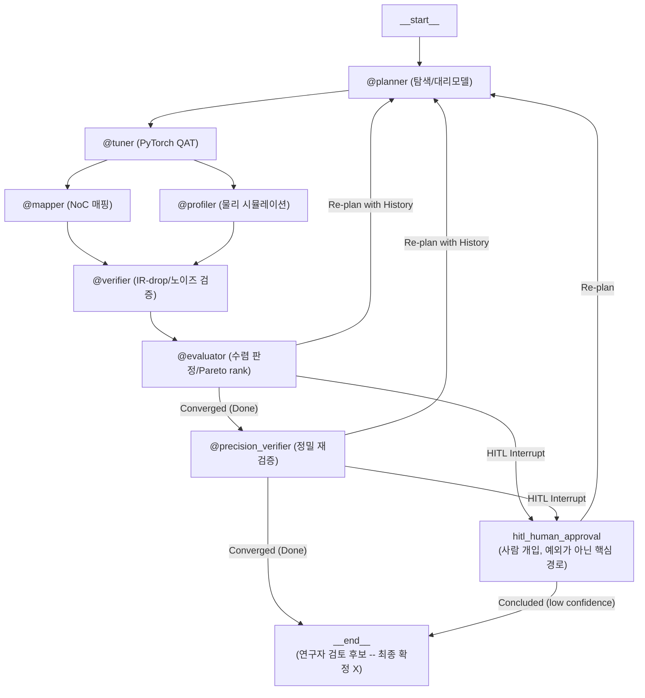

# Tessellate

CIM(Compute-In-Memory) 가속기의 양자화 설정과 하드웨어 제약을 함께 탐색하고, 후보마다 실제로 학습과 물리 시뮬레이션을 돌려 검증하는 연구 플랫폼입니다. LangGraph 기반 8개 노드로 이루어진 폐루프입니다.

레이어별 양자화 비트와 컬럼 프루닝 비율을 크로스바 제약(ADC/DAC 해상도, IR-drop, 소자 노이즈) 아래에서 탐색해 정확도와 에너지, 지연시간의 파레토 후보를 냅니다.

**탐색이 사람이나 더 단순한 방법보다 낫다고 주장하는 프로젝트가 아닙니다.** 자리 표시자를 실제 물리 모델로 하나씩 교체한 과정, 그 과정에서 찾은 버그, 이 시스템이 잘하는 것과 못하는 것을 실측으로 적어 둔 기록입니다.

처음 보신다면 [`docs/concepts.md`](docs/concepts.md)의 개념 설명부터, 결과만 보시려면 [`docs/results.md`](docs/results.md)로 가시면 됩니다.

## 아키텍처

`__end__`는 최종 확정이 아니라 **사람이 검토할 후보가 준비됐다는 뜻**입니다. `hitl_human_approval`도 예외 경로가 아니라 실제로 자주 타는 설계상 핵심 경로입니다.



| 노드 | 역할 |
|---|---|
| `@planner` | 탐색이 수치를 정하고, LLM은 근거 설명과 이상 징후 표시만 담당 |
| `@tuner` | 컬럼별 가중치·부분합 양자화와 구조적 프루닝으로 실제 QAT 수행 |
| `@mapper` / `@profiler` | NoC 매핑, ADC/DAC/크로스바 에너지와 지연 시뮬레이션 |
| `@verifier` | IR-drop과 노이즈 마진으로 수렴 판정 |
| `@evaluator` | 스키마 검증, 파레토 랭크, 재탐색과 HITL 라우팅 |
| `@precision_verifier` | 수렴 후보만 2단계 재검증하고 보정 계수 갱신 |

> **한계가 셋 있습니다.** `@mapper`와 `@profiler`는 정밀 시뮬레이터가 아니라 물리 법칙 기반 근사이고, 학습 데이터는 CIFAR10 서브셋이며, NSGA-II 탐색은 15개 내외의 실측 워밍업 후보로 학습한 대리모델 위에서 돕니다. 후보 사이의 상대 비교에는 쓸 수 있으나 절대 수치를 벤치마크나 제품 규격으로 인용할 수는 없습니다. 자세한 내용은 [`docs/limitations.md`](docs/limitations.md)에 있습니다.

노드별 구현 범위와 HITL 이후의 두 경로는 [`docs/architecture.md`](docs/architecture.md)에 있습니다.

## 멀티에이전트 시스템이 아닙니다

이름과 초기 기획서([`docs/research_plan.md`](docs/research_plan.md))가 "자율 멀티에이전트"를 표방하지만, **실제 구현은 그렇지 않고 그건 의도된 결과입니다.** 코드 기준 사실은 이렇습니다.

| | 실제 |
|---|---|
| 그래프 노드 수 | 8개 (`graph.py`) |
| LLM을 호출하는 노드 | **1개**, `@planner` (`nodes/planner.py`의 `_explain_decision`) |
| 그 LLM이 반환하는 것 | `rationale` / `rationale_ko` / `anomaly_note`, **`layer_configs`는 반환하지 않음** |
| 수치를 정하는 주체 | `tools/search.py`의 NSGA-II (`pymoo`) |
| 다음 노드를 정하는 주체 | `evaluator_router`, `is_converged`/`needs_hitl` 불리언을 읽는 결정론적 함수 |

나머지 7개 노드는 전부 `state -> tool -> metrics_store` 형태의 결정론적 함수입니다. LLM도, 자율성도, 노드 간 협상도 없습니다. 통상적인 의미의 멀티에이전트(LLM이 스스로 제어 흐름을 정하는 주체가 여럿)에 해당하는 요소가 0개이고, 하나뿐인 LLM조차 수치 결정권도 라우팅 권한도 갖고 있지 않습니다. 정확한 분류는 **agentic workflow**(고정 토폴로지 + 조건부 라우팅 + 피드백 루프 + HITL 인터럽트)입니다.

**LLM을 강등시킨 이유는 실측입니다.** 초기 구현은 기획서대로 LLM에게 `weight_bits`/`column_pruning_ratio` 결정권을 줬는데, 실제 운영 실행에서 로컬 tool-calling 모델이 정확도 미달 상황에 대해 *"정확도를 높이기 위해 weight_bits를 낮춘다"* 는 정반대 방향의 추론을 했고, 그 결과 탐색 알고리즘 자신의 제안보다 나쁜 후보가 조용히 채택됐습니다. 이 관찰 이후 LLM의 강제 tool call을 근거 설명과 이상 징후 플래깅으로 좁혔고(`schemas/planner.py`의 `PlannerLayerDecision`), 지금은 **LLM 호출이 실패해도 탐색은 그대로 진행됩니다**, 실패 시 rationale이 템플릿 문구로 대체될 뿐입니다.

설계 선택의 배경은 [`docs/design_rationale.md`](docs/design_rationale.md)에 있습니다.

## 실측 결과

전부 실제 실행에서 나온 것입니다. 유리한 것과 불리한 것을 같이 적었습니다.

- 3회 독립 반복에서 Optuna TPE 기준선 대비 평균 정확도 **0.691과 0.524**를 얻었고 95퍼센트 신뢰구간이 겹치지 않았습니다.
- 크로스바 배열 수를 레이어 단위로 단순 계산하던 초기 물리 모델이 ResNet-18에서 배열 통과 횟수를 **약 70배 과소평가**하고 있었습니다. 모델을 수정하고 이전 결과를 다시 측정했으며 결론은 유지되었습니다.
- 정확도 하한을 주지 않으면 탐색이 정확도를 크게 희생합니다. 하한을 줘도 **3개 시드 중 1개만 수렴**했습니다.
- 언어 모델에 수치 결정권을 주었을 때 정확도 미달 상황에서 반대 방향으로 추론했습니다. 그 관찰 이후 권한을 근거 설명과 이상 징후 표시로 좁혔습니다.
- 최저 에너지 지점은 탐색이 아니라 무작위 워밍업이 찾았고, 시스템은 그 후보를 고르지 않았습니다.

수치의 출처와 재현 명령은 [`docs/results.md`](docs/results.md)에 있습니다.

## 설치

가상환경 사용을 권장합니다 (전역 site-packages와의 충돌 방지, 아래 "문제 해결" 참고). `torch`/`torchvision`은 버전만 고정돼 있고 실제 wheel(CPU 전용 vs CUDA)은 어느 index에서 설치하느냐로 결정되므로, **처음부터 아래 명령으로 명시적으로 골라서 설치**하세요. index 없이 `pip install -r requirements.txt`만 먼저 실행한 뒤 나중에 다른 wheel로 바꾸려 하면, pip가 버전 번호(`2.13.0`)만 보고 "이미 설치됨"으로 판단해 `--index-url`을 바꿔도 조용히 무시합니다(`--force-reinstall` 없이는 안 바뀜, 아래 "문제 해결" 참고).

**Windows/Linux** (기본값: GPU/CUDA, 이 wheel은 CPU 연산도 그대로 지원하므로 GPU가 없어도 문제없이 동작합니다. 용량만 CPU 전용보다 큽니다):

```bash
python -m venv .venv
.venv/Scripts/activate  # Windows; Linux는 source .venv/bin/activate
pip install torch==2.13.0 torchvision==0.28.0 --index-url https://download.pytorch.org/whl/cu130
pip install -r requirements.txt
```

다운로드 용량을 줄이고 싶거나 GPU를 아예 쓸 계획이 없다면(CI/Docker가 이 방식 사용) CPU 전용으로:

```bash
pip install torch==2.13.0 torchvision==0.28.0 --index-url https://download.pytorch.org/whl/cpu
pip install -r requirements.txt
```

**macOS**: CUDA index 자체가 없습니다 (Apple Silicon은 MPS). index-url 없이 그냥 설치하면 됩니다:

```bash
python -m venv .venv
source .venv/bin/activate
pip install -r requirements.txt
```

설치 후 `python -c "import torch; print(torch.__version__); print(torch.cuda.is_available())"`로 어느 wheel이 깔렸는지/GPU 인식 여부를 확인할 수 있습니다. 새 venv에서 위 순서대로 설치 후 `pytest`까지 정상 통과하는 걸 확인했습니다 (282개 테스트).

## 실행

`@planner`(llm.py)는 기본적으로 **로컬 Ollama 모델**(`ollama:qwen2.5:7b`)을 사용합니다. 하드웨어 스펙/후보 설정을 외부 클라우드로 보내지 않아도 되도록, IP에 민감한 배포(반도체 회사 등)를 염두에 둔 기본값입니다. 처음 실행 전 한 번만:

```bash
# https://ollama.com 에서 Ollama 설치 후
ollama pull qwen2.5:7b
ollama serve   # 보통 설치 시 자동으로 백그라운드 서비스로 등록됨

python main.py --model-id resnet18 --dashboard-out report.html
```

클라우드 provider를 쓰고 싶으면 `TESSELLATE_PLANNER_MODEL`을 설정하면 됩니다 (`langchain.chat_models.init_chat_model` 스펙 문자열). `.env.example`을 `.env.local`로 복사해 값을 채우면, `main.py`가 실행할 때마다 자동으로 읽어들이므로 (import 시점이 아니라 `python main.py` 실행 시점에만; gitignore됨), 터미널을 새로 열 때마다 다시 `export`할 필요가 없습니다:

```bash
cp .env.example .env.local
# .env.local을 열어 TESSELLATE_PLANNER_MODEL과 해당 provider의 API 키를 채우기

python main.py --model-id resnet18 --dashboard-out report.html
```

또는 기존처럼 셸에서 직접 `export`해도 동일하게 동작합니다:

```bash
export TESSELLATE_PLANNER_MODEL="anthropic:claude-sonnet-4-5-20250929"
export ANTHROPIC_API_KEY="..."

python main.py --model-id resnet18 --dashboard-out report.html
```

`@planner`는 `PlannerLayerDecision`을 forced tool-calling(`tool_choice=<정확한 도구 이름>`)으로 호출하는데, 이걸 실제로 지원하지 않거나 필수 필드를 빠뜨리는 provider/모델도 있습니다. 아래는 실제로 end-to-end(실제 resnet18/mobilenet_v2+CIFAR10 QAT 포함, 10~20-stage `layer_configs` 리스트 전부)로 검증된 조합입니다:

| Provider | 모델 | 비고 |
|---|---|---|
| Ollama (로컬, 기본값) | `ollama:qwen2.5:7b` | resnet18(10 stage)/mobilenet_v2(20 stage) 전부 검증됨. `qwen2.5:14b`는 이 프로젝트의 forced tool-calling 프롬프트에서 오히려 빈 응답을 자주 반환해 비권장 |
| Anthropic | `anthropic:claude-sonnet-4-5-20250929` | 클라우드 중 기본 권장 |
| Groq (무료 티어 가능) | `groq:llama-3.3-70b-versatile` | `llama-3.1-8b-instant`는 `LayerBitConfig`의 필수 필드(`activation_bits`)를 종종 빠뜨려 실패함. 더 작은 모델로 바꾸기 전에 스키마 준수를 직접 확인할 것 |
| Google Gemini (무료 티어 가능) | `google_genai:gemini-3.5-flash-lite` | 스키마 준수 확인됨, 토큰 소모 적음. `gemini-3.5-flash`도 되지만 내부 reasoning 토큰 때문에 같은 요청에 ~2배 더 많은 토큰을 씀 |

Groq/Gemini를 쓰려면 `pip install -r requirements.txt`에 이미 포함된 `langchain-groq`/`langchain-google-genai`가 필요하고, 각각 `GROQ_API_KEY`/`GOOGLE_API_KEY` 환경변수를 설정하면 됩니다.

### 교차 세션 학습과 재현성

`main.py`는 교차 세션 학습(`store.py`)을 합니다. 이전 세션이 저장한 보정계수와 Pareto 후보를 다음 세션이 이어받아, 같은 하드웨어를 반복 실행할 때 정밀 시뮬레이션을 다시 하지 않습니다. 의도된 기능이지만 두 가지 함정이 있었고, 둘 다 실제로 겪은 뒤 제거했습니다.

- **물리 모델이 바뀌면 옛 데이터가 조용히 섞이던 문제.** `tools/cim_physics.py`의 `ENERGY_MODEL_VERSION`으로 해소. 에너지에서 파생된 저장 항목(보정계수, Pareto 후보)은 이 버전을 키에 붙여 저장하므로, 물리 모델이 바뀌면 이전 항목이 **자동으로 보이지 않게 되어** 콜드 스타트합니다. 실제 사고: v1(항목당 크로스바 1개)에서 저장된 후보 5개가 v2(실제 패스 수) 실행에 로드되어 **약 70배 차이 나는 에너지가 한 표에 섞였습니다.**
- **학습된 계수와 문헌 계수가 달라 비교가 깨지던 문제.** `--ignore-learned-state` 플래그로 해소. `baseline_compare`/`optuna_compare`는 학습을 하지 않고 항상 문헌 부트스트랩을 쓰므로, `main.py` 결과를 그 수치와 나란히 놓으려면 이 플래그가 필요합니다 (실측: 문헌 166.93x vs 학습 51.85x, 동일 하드웨어에서 **3.2배 차이**). 이 플래그는 워밍업 건너뛰기도 함께 막아, LHS 워밍업이 정상적으로 수행됩니다. 두 계수가 2배 이상 벌어지면 세션 시작 시 `[calibration] 주의:` 한 줄로 알려줍니다.

```bash
# baseline_compare/optuna_compare 수치와 비교할 세션
python main.py --model-id resnet18 --hw-config examples/hw_configs/default_cim_v1_128x128.json \
  --ignore-learned-state --target-accuracy 0.7
```

**`--hw-config`를 생략하고 터미널에서 직접 실행하면**, 매번 JSON 파일 경로를 손으로 쓰는 대신 대화형으로 물어봅니다: (1) 커스텀 값 직접 입력 (2) 저장된 예시 파일(`examples/hw_configs/`) 중 선택 (3) 기본값 사용. 직접 입력 시 각 필드에서 `b`(또는 `back`/`뒤로`)를 입력하면 바로 앞 필드로 돌아가 다시 입력할 수 있고(맨 첫 필드에서 입력하면 [1]/[2]/[3] 메뉴로 돌아감), 스키마 검증에 실패해도(예: `noc_topology`에 오타) 이미 입력한 다른 필드는 그대로 유지된 채 문제된 필드만 원래 기본값으로 재설정됩니다. 입력한 스펙이 `tools/calibration.py`의 레퍼런스와 정확히 일치하지 않으면, 그 자리에서 가장 가까운 레퍼런스로 근사 보정할지 물어보며 기본값은 "예"입니다(`--exact-calibration-only`로 전역 opt-out과 동일한 효과를 내려면 그 자리에서 "n"으로 답하면 됩니다). `--hw-config`를 명시하거나 스크립트/CI처럼 터미널이 아닌 환경에서 실행하면 이 프롬프트는 뜨지 않고 기존과 동일하게 동작합니다.

> **GPU 환경 주의**: 워밍업은 항상 병렬로 실행되지만, 단일 CUDA GPU에서는 여러 스레드가 동시에 cudnn을 호출하면 메모리 경쟁을 넘어 크래시(`CUDA error: invalid resource handle` 등)가 날 수 있어서, `--parallel-warmup-workers`를 명시하지 않으면 CUDA에서는 자동으로 1개 워커(사실상 순차 실행)로 기본값이 설정됩니다. 여러 워커를 쓰려면 `--parallel-warmup-workers`를 직접 지정하세요(안정성은 직접 확인 필요). CPU/MPS에서는 기존처럼 `min(워밍업 후보 수, CPU 코어 수)`가 기본값입니다.

주요 CLI 옵션 (`main.py`):

| 옵션 | 설명 |
|---|---|
| `--model-id` | 대상 모델 (`resnet18`, `mobilenet_v2`, `vit_tiny`) |
| `--hw-config PATH` | `HWConfig` 필드를 담은 JSON 파일 (생략 시 내장 샘플 스펙 사용). 예시는 [`examples/hw_configs/`](examples/hw_configs/) 참고 |
| `--thread-id ID` | 세션 재개용 LangGraph thread id |
| `--checkpoint-db PATH` | 체크포인트 SQLite 경로 (`:memory:`로 영속성 끄기 가능) |
| `--dashboard-out PATH` | 세션이 멈추거나 끝날 때마다 HTML 대시보드를 이 경로에 기록 |
| `--list-sessions` | `--checkpoint-db`에 저장된 모든 세션(thread_id, 상태, iteration_count)을 나열하고 종료 |
| `--parallel-warmup-workers N` | 새 세션 시작 시 LHS 워밍업 후보 전체를 순차 그래프 루프 진입 전에 스레드 풀로 동시 평가 (`tools/batch_warmup.py`), 이 단계는 HITL 없이 항상 끝까지 자동 진행됨. N은 스레드 수 조절용(생략 시 기본값 `min(워밍업 후보 수, CPU 코어 수)`). 단, 이전 세션에서 학습된 Pareto 후보가 이미 있으면 이 단계는 건너뜀 |
| `--target-accuracy FLOAT` | (opt-in) 이 정확도 이상이어야 "수렴(Converged)"으로 인정, `@verifier`의 IR-drop/노이즈 검사만으로는 실제 정확도가 낮아도 수렴 처리될 수 있어서 추가된 게이트. 생략 시 기존처럼 정확도는 게이트하지 않음 (`nodes/evaluator.py`) |
| `--target-energy-pj FLOAT` | (opt-in) 이 값 이하여야 수렴으로 인정 |
| `--target-latency-ms FLOAT` | (opt-in) 이 값 이하여야 수렴으로 인정 |
| `--search-budget-iterations N` | (opt-in) 목표를 만족한 *첫* 후보에서 멈추지 않고 N회까지 탐색한 뒤, 목표를 충족한 후보 중 **최선**을 답으로 고름 (워밍업 후보도 실제 평가이므로 N에 포함). 생략 시 기존 동작(첫 충족 후보에서 정지)이며, 일반 실행에는 그게 맞습니다. 이 플래그는 "전부 평가하고 최고점을 보고하는" 그리드와 **같은 선택 규칙**으로 맞춰 비교할 때를 위한 것입니다 (`state.py`, 위 실측 결과 참고) |
| `--exact-calibration-only` | (opt-out) 기본값은 `--hw-config`가 `tools/calibration.py`의 `KNOWN_REFERENCES`와 정확히 일치하지 않을 때 가장 가까운 레퍼런스의 보정 계수를 스케일링 로우 기반으로 근사 적용하는 것(`bootstrap_approximate_calibration_factors`). 이 플래그를 주면 예전처럼 정확히 일치하지 않는 하드웨어를 미보정(factor=1.0) 상태로 남겨두는 엄격한 동작으로 되돌아감. 근사 적용 여부와 매칭된 레퍼런스/거리는 세션 시작 시 `[calibration] ...` 로그로 항상 출력됨 |

> **`--target-*` 미달 시 동작**: 기존 `MAX_RETRY_LIMIT`(3회) 재시도 후 HITL 흐름을 그대로 재사용합니다. 목표 미달 후보도 `candidate_history`에는 정상 기록됩니다(surrogate 학습에 유효한 데이터이므로), 다만 `is_converged=False`로 남아 재탐색을 계속 유도합니다.

### 주요 환경변수

| 변수 | 용도 |
|---|---|
| `TESSELLATE_PLANNER_MODEL` | (옵션) LLM provider:model 스펙, 생략 시 로컬 `ollama:qwen2.5:7b` 사용 |
| `TESSELLATE_LLM_MAX_RETRIES` / `_BASE_DELAY_SECONDS` / `_MAX_DELAY_SECONDS` | LLM 호출 재시도/백오프 튜닝 |
| `TESSELLATE_LLM_COST_PER_1K_INPUT_USD` / `_OUTPUT_USD` | 토큰당 비용 추정 활성화 (미설정 시 비용은 항상 `null`) |
| `TESSELLATE_LLM_MAX_TOTAL_COST_USD` / `TESSELLATE_LLM_MAX_TOTAL_TOKENS` | 런 전체 누적 상한 도달 시 LLM 호출 자체를 중단 |
| `TESSELLATE_LOG_DIR` | 구조화 로그(JSONL) 저장 위치 (기본 `.cache/logs/`) |
| `TESSELLATE_QAT_TRAIN_SIZE` / `_VAL_SIZE` / `_TEST_SIZE` / `_BATCH_SIZE` | QAT fine-tuning/평가 데이터셋 크기 (기본 512/128/1000/32, CIFAR10 데모 서브셋). `TRAIN_SIZE`/`TEST_SIZE`는 `full`로 설정하면 해당 split 전체 사용 (wall-clock 증가) |
| `TESSELLATE_QAT_SEED` | QAT train/val/test 분할 시드 (기본 0) |
| `TESSELLATE_QAT_DEVICE` | QAT 학습에 사용할 디바이스 (`cuda`, `mps`, `cpu`, `cuda:0` 등). 미설정 시 CUDA, MPS, CPU 순으로 자동 감지 |

## Docker

```bash
docker build -t tessellate .
```

`.cache/`(체크포인트 DB, 다운로드된 모델 가중치/CIFAR10)를 마운트하지 않으면 `--rm`으로 컨테이너가 사라질 때 전부 같이 사라집니다. 매 실행마다 다시 다운로드하고, `--thread-id` 세션 재개도 안 됩니다. `--dashboard-out`으로 쓰는 파일도 마찬가지로 마운트해야 컨테이너 밖에서 열어볼 수 있습니다:

```bash
docker run --rm \
  --env-file .env.local \
  -v "$(pwd)/.cache:/app/.cache" \
  -v "$(pwd)/report.html:/app/report.html" \
  tessellate --model-id resnet18 --dashboard-out report.html
```

(`--env-file .env.local`은 `-e TESSELLATE_PLANNER_MODEL=... -e ANTHROPIC_API_KEY=...`를 하나씩 나열하는 대신 `.env.local` 내용을 그대로 전달합니다.)

> **로컬 Ollama 기본값과 Docker**: 컨테이너 안에서는 `ollama:qwen2.5:7b` 기본값이 가리키는 `localhost:11434`가 컨테이너 자신을 가리켜 호스트의 Ollama에 닿지 않습니다. `-e OLLAMA_HOST=http://host.docker.internal:11434`로 호스트의 Ollama를 가리키거나, `.env.local`에서 `TESSELLATE_PLANNER_MODEL`을 클라우드 provider로 오버라이드하세요.

> **Docker 이미지에서만 활성화되는 실제 시뮬레이터**: `requirements-docker.txt`가 `requirements.txt` 위에 `hwcomponents-neurosim`과 `hwcomponents-cacti`를 추가로 설치합니다. 전자는 `pip install` 시점에 NeuroSim의 실제 C++ 소스를 `make`/`g++`로 컴파일하므로(이미지에 `build-essential` 설치 단계 포함, 첫 빌드가 그만큼 오래 걸림) C++ 툴체인이 없는 로컬 환경에서는 애초에 설치할 수 없고, 후자는 컴파일은 필요 없지만 POSIX 전용 `fcntl`을 import해서 Windows에서 로드 자체가 안 됩니다. 설치되면 `@precision_verifier`(`tools/precision_check.py`)의 DAC/크로스바-MAC 에너지 항이 NeuroSim의 실제 device 모델(`RowDrivers`/`MemoryCell`)로, SRAM 버퍼 스테이징 에너지(`HWConfig.sram_buffer_kb` 설정 시)가 CACTI의 실제 `SRAM` 모델로 자동 전환됩니다. 코드 변경 없이, Docker로 실행한다는 사실 자체가 이 전환을 켭니다. `--hw-config`에 `device_type`(`rram`/`sram`/`pcm`/`sttram`)을 명시하면 NeuroSim의 제네릭 placeholder 셀 대신 해당 소자의 실제 NVMExplorer-fit `.cell` 설정을 사용합니다 (`examples/hw_configs/`의 `calibrated_*.json`들이 이미 이렇게 설정돼 있음); 생략하면 여전히 placeholder 셀로 폴백합니다.

## 테스트

```bash
ruff check .
pytest
```

대부분 stub 백엔드(가짜 LLM, 합성 모델/데이터)로 동작해 네트워크/실제 학습 없이 완료됩니다. `tests/conftest.py`의 autouse fixture가 실제 QAT 학습·LLM API 호출을 자동으로 가짜로 대체합니다 (`tests/test_qat.py`의 `group_quantizable_layers` 검증 테스트 몇 개만 예외적으로 실제 resnet18/mobilenet_v2/vit_tiny 아키텍처 클래스를 직접 생성합니다. `weights=None`/`pretrained=False`라 체크포인트 다운로드는 없습니다). `.github/workflows/ci.yml`이 push/PR마다 lint(`ruff check .`) + 테스트를 동일하게 실행합니다.

## 문제 해결

**`ImportError`/`numpy._core._multiarray_umath` 관련 에러, 또는 엉뚱한 패키지 버전이 로드됨**
`PYTHONPATH` 환경변수가 이 프로젝트와 무관한 다른 프로젝트의 venv를 가리키고 있을 가능성이 높습니다. `PYTHONPATH`는 **가상환경을 새로 만들어도 사라지지 않고 그대로 상속**되며, venv 자체의 site-packages보다 먼저 검색되기 때문에 다른 프로젝트의 패키지가 이 프로젝트의 것보다 우선 로드될 수 있습니다.

```bash
echo $PYTHONPATH        # 값이 있고, 이 프로젝트와 무관해 보인다면 원인일 가능성이 높음
PYTHONPATH= pytest      # 임시로 비우고 재실행해서 확인
```

원인이 맞다면 셸 프로필(`.bashrc`/`.zshrc`/Windows 환경변수)에서 `PYTHONPATH`를 제거하거나, 이 프로젝트를 실행할 때마다 `PYTHONPATH=` 로 비워서 실행하세요. CI(`ci.yml`)와 이 README의 예시 명령어들은 전부 이렇게 명시적으로 비운 상태로 실행됩니다.

**GPU가 있는데도 `main.py` 실행 시 `QAT device=cpu`로 나옴**
어떤 torch wheel이 깔렸는지부터 확인하세요:

```bash
python -c "import torch; print(torch.__version__); print(torch.cuda.is_available())"
```

버전 뒤에 `+cu`로 시작하는 접미사(예: `2.13.0+cu130`)가 없으면 CPU 전용 wheel이 깔린 겁니다. CUDA wheel은 CPU 전용 wheel의 상위 호환(CPU 연산도 그대로 되고 GPU가 추가되는 것)이라, 바꿔 깔아도 기존 동작이 깨지진 않습니다. 단, **이미 torch가 설치돼 있는 상태**(예: 위 "설치" 섹션의 순서를 안 지키고 index 없이 먼저 설치한 경우)라면 반드시 `--force-reinstall`을 붙이세요:

```bash
pip install --force-reinstall --no-deps torch==2.13.0 torchvision==0.28.0 --index-url https://download.pytorch.org/whl/cu130
```

`--force-reinstall` 없이 그냥 다시 설치하면, pip가 버전 번호(`2.13.0`)만 보고 "이미 설치됨"으로 판단해 **아무 것도 하지 않고 조용히 넘어갑니다**, wheel이 하나도 안 바뀌었는데 명령이 성공한 것처럼 보여서 헷갈리기 쉽습니다. (`--no-deps`는 torch 외 의존성까지 불필요하게 재설치하지 않기 위함입니다.)

`+cu130` 접미사가 이미 있는데도 `torch.cuda.is_available()`이 `False`라면 torch 문제가 아니라 NVIDIA 드라이버/GPU 인식 쪽 문제입니다 (예: GPU가 NVIDIA가 아니거나 드라이버가 이 CUDA 버전을 지원하지 않음).

## 프로젝트 구조

```
graph.py, main.py, state.py, llm.py, middleware.py,
observability.py, store.py   # 코어 오케스트레이션/런타임 (LangGraph 조립, 상태 스키마, LLM 운영, 구조화 로깅)
nodes/                        # 8개 그래프 노드 함수 (LLM을 쓰는 건 @planner 하나뿐)
tools/                        # 백엔드 시뮬레이터 (QAT, 물리 시뮬레이션, 탐색 알고리즘, 병렬 워밍업, 대시보드)
schemas/                      # Pydantic 입출력 스키마
tests/                        # pytest 스위트 (전부 stub 기반)
docs/                         # 개념, 아키텍처 상세, 실측 결과, 설계 근거, 한계, 로드맵
examples/hw_configs/          # --hw-config 예시 JSON
examples/custom_model_dataset/ # --model-id/--dataset-id 커스텀 스펙 예시 (코드 변경 없이 자체 모델/데이터셋 연결)
```

## 문서

| 문서 | 내용 |
|---|---|
| [`docs/concepts.md`](docs/concepts.md) | CIM, 크로스바, ADC/DAC, 양자화, 파레토 탐색 개념 |
| [`docs/architecture.md`](docs/architecture.md) | 노드별 구현 범위, HITL 이후 경로 |
| [`docs/results.md`](docs/results.md) | 실측 결과 전문과 재현 명령 |
| [`docs/limitations.md`](docs/limitations.md) | 스코프 한계 |
| [`docs/design_rationale.md`](docs/design_rationale.md) | 설계 선택의 근거 |
| [`docs/prior_work.md`](docs/prior_work.md) | 선행 연구에서 가져온 것과 구현하지 않은 것 |
| [`docs/research_plan.md`](docs/research_plan.md) | 초기 기획서 |
| [`docs/roadmap.md`](docs/roadmap.md) | 완료한 것과 다음 단계 |

## 라이선스

[BSD-3-Clause](LICENSE). 이 프로젝트를 인용할 때는 [`CITATION.cff`](CITATION.cff)를 참고하세요.
